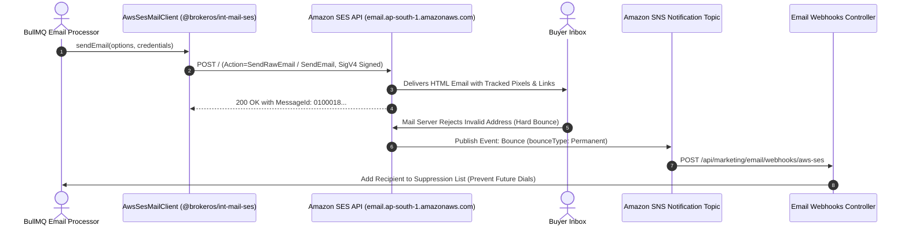

**Amazon Simple Email Service (SES)** is Amazon Web Services' high-scale email platform. At approximately $0.10 per 1,000 emails, it is the most economical solution for real estate brokerages sending high-volume tower launches, construction updates, and payment demand letters.

The BrokerOS integration (`@brokeros/int-mail-ses`) uses AWS Signature Version 4 (SigV4) to authenticate directly with Amazon SES REST endpoints and processes delivery telemetry via Amazon SNS.

---

## AWS SES Email Pipeline



---

## Required Credentials

To connect AWS SES to BrokerOS, generate an IAM User credential set with Amazon SES permissions:

| Credential Field | Parameter in BrokerOS | Requirements & Format |
| :--- | :--- | :--- |
| **AWS Access Key ID** | `AWS Access Key ID` | 20-character uppercase alphanumeric string (e.g., `AKIA...`). |
| **AWS Secret Access Key** | `AWS Secret Key` | 40-character secret key string. |
| **AWS Region** | `AWS Region` | Target region (e.g., `ap-south-1` for Mumbai, `us-east-1` for N. Virginia). |
| **Verified Sending Email** | `From Email` | Verified email identity (e.g., `updates@skylinerealty.com`). |
| **Sender Display Name** | `From Name` | Friendly sender name (e.g., *Skyline Realty Advisory*). |

---

## Configuration Steps

<Steps>
  <Step title="Verify Sending Domain in AWS SES Console">
    Open the [Amazon SES Console](https://console.aws.amazon.com/ses/). Under **Configuration -> Verified Identities**, create a Domain Identity for your sending domain. Add the 3 CNAME DKIM records provided by AWS into your DNS provider (Cloudflare, GoDaddy, Route 53).
  </Step>

  <Step title="Request Production Access (Exit Sandbox)">
    New AWS accounts operate in the SES Sandbox and can only send to verified addresses. Submit a **Production Access Request** in the SES Console specifying your real estate audience acquisition methods and opt-in policies. Approvals typically clear within 24 hours.
  </Step>

  <Step title="Add AWS SES in BrokerOS Settings">
    In the BrokerOS dashboard:
    1. Navigate to **Dashboard -> Marketing -> Email -> Settings**.
    2. Select the **Providers & Domains** tab (`/dashboard/marketing/email/settings?tab=providers`).
    3. Click **Add Provider** and select **AWS SES**.
    4. Fill in the modal fields: **Account Name**, **From Name**, **From Email**, **AWS Access Key ID**, **AWS Secret Key**, and **AWS Region** (e.g. `ap-south-1`).
    5. Click **Verify & Connect**: BrokerOS verifies IAM permissions, encrypts the credentials via AES-256-GCM, and saves them to `MarketingIntegration`.
  </Step>

  <Step title="Configure Amazon SNS Event Destination">
    In the SES Console under your verified identity, configure **Event Publishing** to send Bounce, Complaint, Delivery, Open, and Click events to an Amazon SNS Topic subscribed to:
    ```
    https://api.yourdomain.com/api/marketing/email/webhooks/aws-ses
    ```
    BrokerOS automatically handles the SNS `SubscriptionConfirmation` challenge and starts processing delivery events.
  </Step>
</Steps>
