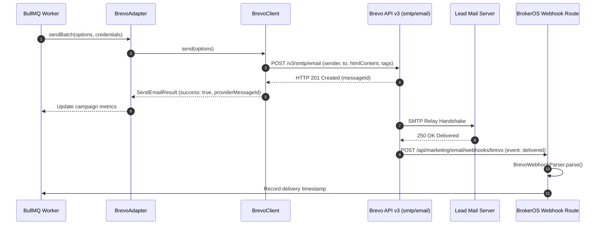

## Overview

Brevo (formerly Sendinblue) provides European-hosted email delivery infrastructure engineered for enterprise compliance with GDPR and international data sovereignty standards. In BrokerOS, the Brevo integration lives as a self-contained TypeScript package in [`integrations/mail/brevo/src/index.ts`](file:///c:/Users/Sumama/Desktop/enterprise-crm-realtors/integrations/mail/brevo/src/index.ts) under the Turborepo workspace package `@brokeros/int-mail-brevo`.

BrokerOS administrators configure and manage Brevo directly through the Web UI at **Dashboard -> Marketing -> Email -> Settings**. Credentials are encrypted using AES-256-GCM and stored in the database (`MarketingIntegration`), requiring zero server restarts or `.env` modifications.

---

## Architecture and Dispatch Sequence

The Brevo integration implements the `IEmailMarketingProvider` contract from [`@brokeros/types`](file:///c:/Users/Sumama/Desktop/enterprise-crm-realtors/packages/types). During campaign execution, worker jobs stream batches through `BrevoClient` without blocking API request threads.



---

## Step 1: Obtain Credentials from Brevo

1. Log into your account at [app.brevo.com](https://app.brevo.com).
2. Click your profile name in the top right corner and navigate to **SMTP & API**.
3. Under the **API Keys** tab, click **Generate a new API key**.
4. Name your key (e.g. `BrokerOS Production`) and copy the generated key string. Brevo v3 API keys start with `xkeysib-` and are at least 40 characters long.
5. Navigate to **Senders, Domains & Dedicated IPs -> Domains**, add your company sending domain, and publish the recommended DKIM (`k=rsa; p=...`) and Brevo code TXT records to your DNS provider.

---

## Step 2: Connect in the BrokerOS Web Dashboard

In your BrokerOS dashboard, connect Brevo through the UI modal:

1. Navigate to **Dashboard -> Marketing -> Email -> Settings**.
2. Select the **Providers & Domains** tab (`/dashboard/marketing/email/settings?tab=providers`).
3. Click **Add Provider** and select **Brevo** from the provider catalog.
4. Fill in the modal connection fields:

| UI Modal Field | Required | Description & Example |
| :--- | :--- | :--- |
| **Account Name** | Yes | Friendly label in CRM (e.g. `Brevo European Gateway`). |
| **From Name** | Yes | Display sender name (e.g. `Skyline Realty Sales Team`). |
| **From Email** | Yes | Corporate address matching your verified domain (e.g. `sales@skylinerealty.com`). |
| **v3 API Key** | Yes | Secret key starting with `xkeysib-...` generated in Brevo. |
| **Set as Default** | Optional | Check to route outbound campaigns through Brevo by default. |

5. Click **Verify & Connect**. BrokerOS immediately tests connectivity with `GET https://api.brevo.com/v3/account`. Once verified, credentials are encrypted and stored in PostgreSQL (`MarketingIntegration`).

---

## Step 3: Configure Webhook Delivery Telemetry

To capture real-time opens, clicks, and bounce suppression events:

1. In your Brevo portal, navigate to **Transactional -> Settings -> Webhook**.
2. Click **Add a new webhook**.
3. Enter your BrokerOS webhook endpoint URL:
   ```
   https://api.yourfirm.com/api/marketing/email/webhooks/brevo
   ```
4. Select checkboxes for **Delivered**, **Opened**, **Clicked**, **Soft bounce**, **Hard bounce**, **Spam**, and **Unsubscribed**.
5. Save the webhook. BrokerOS `BrevoWebhookParser` handles event ingestion automatically.

---

## Webhook Event Telemetry Mapping

| Brevo Event | BrokerOS Event Type | Stored Metadata | Lead / Campaign Action |
| :--- | :--- | :--- | :--- |
| `delivered` | `DELIVERED` | Provider timestamp | Marks message delivered |
| `opened` / `unique_opened` | `OPENED` | IP, User Agent | Increments campaign open counter |
| `click` | `CLICKED` | Link URL, IP, User Agent | Logs engagement; scores lead |
| `hard_bounce` / `soft_bounce` | `BOUNCED` | Bounce reason string | Flags email as invalid; suppresses future sends |
| `spam` | `SPAM_COMPLAINT` | Timestamp | Blacklists email; triggers compliance alert |
| `unsubscribed` | `UNSUBSCRIBED` | Timestamp | Sets lead subscription preference to opt-out |

---

## Integration Implementation Details

The Brevo integration source code is maintained in [`integrations/mail/brevo/src/index.ts`](file:///c:/Users/Sumama/Desktop/enterprise-crm-realtors/integrations/mail/brevo/src/index.ts).

### Live Account Verification

When submitting credentials in the UI, `BrevoClient.validate()` sends an authenticated ping to verify access rights:

```typescript
export class BrevoClient {
  private apiKey: string;

  constructor(credentials?: ProviderCredentials) {
    this.apiKey = credentials?.apiKey || process.env.BREVO_API_KEY || '';
  }

  async validate(): Promise<boolean> {
    if (!this.apiKey) return false;
    const isBrevoFormat = this.apiKey.startsWith('xkeysib-');
    if (!isBrevoFormat && this.apiKey.length < 20) return false;

    try {
      const res = await fetch('https://api.brevo.com/v3/account', {
        method: 'GET',
        headers: {
          'api-key': this.apiKey,
          Accept: 'application/json',
        },
        signal: AbortSignal.timeout(8000),
      });
      return res.status === 200 || res.status === 403;
    } catch {
      return isBrevoFormat || this.apiKey.length >= 40;
    }
  }
}
```

### Outbound Transactional Dispatch

Worker jobs dispatch outbound messages via `POST https://api.brevo.com/v3/smtp/email` with automatic campaign attribution tags:

```typescript
const payload: Record<string, any> = {
  sender: {
    name: options.fromName,
    email: options.fromEmail,
  },
  to: options.to.map((recipient) => ({
    email: recipient.email,
    name: recipient.name || undefined,
  })),
  subject: options.subject,
  htmlContent: options.htmlContent,
};

if (options.plainTextContent) {
  payload.textContent = options.plainTextContent;
}

if (options.replyTo) {
  payload.replyTo = { email: options.replyTo };
}

if (options.tracking?.campaignId) {
  payload.tags = [`campaign-${options.tracking.campaignId}`];
}
```
