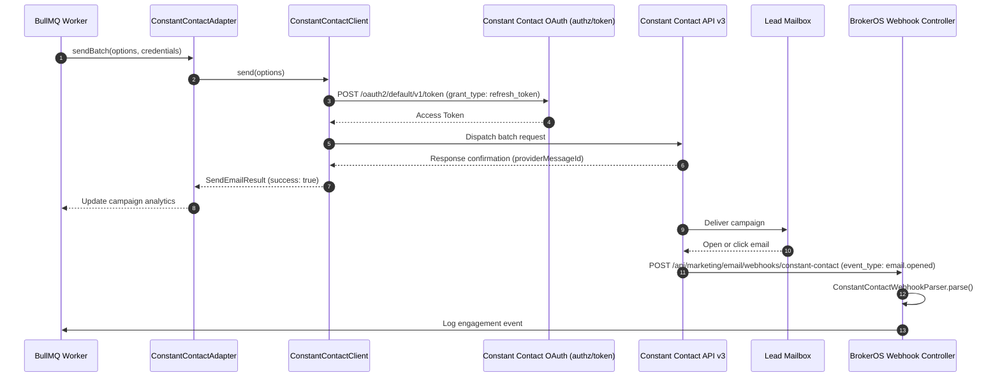

## Overview

Constant Contact is widely used by real estate firms for organizing developer launches, property expos, and high-volume subscriber newsletters. In BrokerOS, the Constant Contact integration lives in [`integrations/mail/constant-contact/src/index.ts`](file:///c:/Users/Sumama/Desktop/enterprise-crm-realtors/integrations/mail/constant-contact/src/index.ts) under the Turborepo workspace package `@brokeros/int-mail-constant-contact`.

BrokerOS administrators configure Constant Contact accounts through the Web UI at **Dashboard -> Marketing -> Email -> Settings**. Tokens are encrypted using AES-256-GCM and stored in PostgreSQL (`MarketingIntegration`).

---

## Architecture and Dispatch Sequence

The Constant Contact integration implements the `IEmailMarketingProvider` contract from [`@brokeros/types`](file:///c:/Users/Sumama/Desktop/enterprise-crm-realtors/packages/types).



---

## Step 1: Obtain Credentials from Constant Contact

1. Log into the [Constant Contact Developer Portal](https://app.constantcontact.com).
2. Navigate to **My Applications** and create a new application.
3. Copy your **API Key (Client ID)** and **App Secret**.
4. Generate an authorization code and exchange it for an offline **Refresh Token** with `contact_data` and `campaign_data` permissions.
5. In your Constant Contact account settings, verify your corporate sending email address.

---

## Step 2: Connect in the BrokerOS Web Dashboard

In your BrokerOS dashboard:

1. Navigate to **Dashboard -> Marketing -> Email -> Settings**.
2. Open the **Providers & Domains** tab (`/dashboard/marketing/email/settings?tab=providers`).
3. Click **Add Provider** and select **Constant Contact**.
4. Fill in the modal connection fields:

| UI Modal Field | Required | Description & Example |
| :--- | :--- | :--- |
| **Account Name** | Yes | Friendly label in CRM (e.g. `Constant Contact Expo Engine`). |
| **From Name** | Yes | Default sender name (e.g. `Luxury Villas Marketing`). |
| **From Email** | Yes | Address confirmed in Constant Contact (e.g. `newsletter@skylinerealty.com`). |
| **API Key** | Yes | Application Client ID from developer portal. |
| **Client Secret** | Yes | Application Secret from developer portal. |
| **Refresh Token** | Yes | Long-lived OAuth refresh token. |

5. Click **Verify & Connect**. BrokerOS tests token renewal against Constant Contact's token endpoint and validates account status via `GET https://api.cc.email/v3/account/summary`. Once confirmed, credentials are encrypted via AES-256-GCM and stored in `MarketingIntegration`.

---

## Step 3: Configure Webhook Delivery Destination

To capture delivery events and unsubscribes:

1. In Constant Contact, set your webhook URL to:
   ```
   https://api.yourfirm.com/api/marketing/email/webhooks/constant-contact
   ```
2. Subscribe to events for Delivered, Opened, Clicked, Bounced, and Unsubscribed.
3. Save changes. Incoming events are routed through `ConstantContactWebhookParser` to update lead engagement.

---

## Integration Implementation Details

The integration logic is located in [`integrations/mail/constant-contact/src/index.ts`](file:///c:/Users/Sumama/Desktop/enterprise-crm-realtors/integrations/mail/constant-contact/src/index.ts).

### OAuth Token Refresh

The client exchanges its refresh token against the Constant Contact token authority before executing API requests:

```typescript
export class ConstantContactClient {
  private apiKey: string;
  private secret?: string;
  private refreshToken?: string;
  private fromEmail?: string;

  constructor(credentials?: ProviderCredentials) {
    this.apiKey = credentials?.constantContactApiKey || credentials?.apiKey || process.env.CONSTANT_CONTACT_API_KEY || '';
    this.secret = credentials?.constantContactSecret || process.env.CONSTANT_CONTACT_SECRET;
    this.refreshToken = credentials?.constantContactRefreshToken || process.env.CONSTANT_CONTACT_REFRESH_TOKEN;
    this.fromEmail = (credentials?.fromEmail || process.env.CONSTANT_CONTACT_FROM_EMAIL || '').trim().toLowerCase();
  }

  private async getAccessToken(): Promise<string | null> {
    if (!this.refreshToken || !this.apiKey || !this.secret) {
      return this.apiKey || null;
    }

    try {
      const authHeader = Buffer.from(`${this.apiKey}:${this.secret}`).toString('base64');
      const res = await fetch('https://authz.constantcontact.com/oauth2/default/v1/token', {
        method: 'POST',
        headers: {
          Authorization: `Basic ${authHeader}`,
          'Content-Type': 'application/x-www-form-urlencoded',
        },
        body: new URLSearchParams({
          grant_type: 'refresh_token',
          refresh_token: this.refreshToken,
        }).toString(),
      });

      if (!res.ok) return this.apiKey || null;
      const data: any = await res.json().catch(() => ({}));
      return data?.access_token || this.apiKey || null;
    } catch {
      return this.apiKey || null;
    }
  }
}
```
