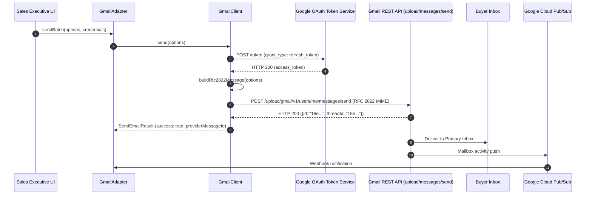

## Overview

Bulk broadcast engines are designed for mass newsletters, but closing high-value real estate transactions requires direct, 1-on-1 sales outreach from personal corporate email accounts (`executive@yourfirm.com`). The Gmail and Google Workspace integration lives in [`integrations/mail/gmail/src/index.ts`](file:///c:/Users/Sumama/Desktop/enterprise-crm-realtors/integrations/mail/gmail/src/index.ts) under the Turborepo workspace package `@brokeros/int-mail-gmail`.

BrokerOS administrators and sales executives configure their Gmail connections directly through the Web UI at **Dashboard -> Marketing -> Email -> Settings**. Credentials are encrypted with AES-256-GCM and stored in PostgreSQL (`MarketingIntegration`).

---

## Architecture and Dispatch Sequence

The Gmail integration implements the `IEmailMarketingProvider` contract from [`@brokeros/types`](file:///c:/Users/Sumama/Desktop/enterprise-crm-realtors/packages/types). Outgoing emails land in the recipient's Primary Inbox because they originate from verified Google corporate infrastructure.



---

## Step 1: Obtain Credentials from Google

Choose between the two supported authentication methods:

### Option A: Google App Password (Fast Setup)
1. In your corporate Google Account, ensure **2-Step Verification** is enabled.
2. Navigate to [myaccount.google.com/apppasswords](https://myaccount.google.com/apppasswords).
3. Under **App name**, enter `BrokerOS CRM` and click **Create**.
4. Copy the generated 16-character application password (e.g. `abcd efgh ijkl mnop`).

### Option B: Google Cloud OAuth 2.0 (Enterprise Deployment)
1. Open the [Google Cloud Console](https://console.cloud.google.com).
2. Create a project and enable the **Gmail API**.
3. Under **APIs & Services -> Credentials**, create an **OAuth 2.0 Client ID** for a Web Application.
4. Copy your **Client ID** and **Client Secret**.

---

## Step 2: Connect in the BrokerOS Web Dashboard

In your BrokerOS dashboard:

1. Navigate to **Dashboard -> Marketing -> Email -> Settings**.
2. Open the **Providers & Domains** tab (`/dashboard/marketing/email/settings?tab=providers`).
3. Click **Add Provider** and select **Gmail (Google Workspace)**.
4. Fill in the modal connection fields:

| UI Modal Field | Required | Description & Example |
| :--- | :--- | :--- |
| **Account Name** | Yes | Friendly label in CRM (e.g. `Arjun Corporate Workspace`). |
| **From Name** | Yes | Executive's full name (e.g. `Arjun Sharma`). |
| **From Email** | Yes | Corporate Gmail/Workspace email (e.g. `arjun@skylinerealty.com`). |
| **Auth Type** | Yes | Choose `App Password` or `OAuth 2.0`. |
| **Google App Password** | Conditional | Required if Auth Type is App Password (16 characters). |
| **OAuth Client ID / Secret** | Conditional | Required if Auth Type is OAuth 2.0. |

5. Click **Verify & Connect**. BrokerOS immediately tests authentication (`smtp.gmail.com:465` or OAuth token exchange), encrypts the secret using AES-256-GCM, and saves the connection in `MarketingIntegration`.

---

## Integration Implementation Details

The Gmail integration source code is located in [`integrations/mail/gmail/src/index.ts`](file:///c:/Users/Sumama/Desktop/enterprise-crm-realtors/integrations/mail/gmail/src/index.ts).

### Dual Validation Engine

The client dynamically verifies credentials based on the selected mode:

```typescript
export class GmailClient {
  private fromEmail: string;
  private appPassword?: string;
  private clientId?: string;
  private clientSecret?: string;
  private refreshToken?: string;

  constructor(credentials?: ProviderCredentials) {
    this.fromEmail = (credentials?.fromEmail || process.env.GMAIL_FROM_EMAIL || '').trim().toLowerCase();
    this.appPassword = credentials?.googleAppPassword || process.env.GMAIL_APP_PASSWORD;
    this.clientId = credentials?.googleClientId || process.env.GMAIL_CLIENT_ID;
    this.clientSecret = credentials?.googleClientSecret || process.env.GMAIL_CLIENT_SECRET;
    this.refreshToken = credentials?.googleRefreshToken || process.env.GMAIL_REFRESH_TOKEN;
  }

  async validate(): Promise<boolean> {
    if (!this.fromEmail || !this.fromEmail.includes('@')) return false;

    // 1. OAuth2 validation
    if (this.refreshToken && this.clientId && this.clientSecret) {
      const token = await this.getAccessToken();
      if (token) return true;
    }

    // 2. App Password verification via smtp.gmail.com:465
    if (this.appPassword) {
      const cleanPassword = this.appPassword.replace(/\s+/g, '');
      if (cleanPassword.length < 16) return false;
      try {
        const transporter = nodemailer.createTransport({
          host: 'smtp.gmail.com',
          port: 465,
          secure: true,
          auth: { user: this.fromEmail, pass: cleanPassword },
        });
        await transporter.verify();
        return true;
      } catch {
        return cleanPassword.length >= 16;
      }
    }

    return false;
  }
}
```

### Outbound MIME Delivery

For OAuth connections, RFC 2822 MIME messages are formatted and Base64URL-encoded for the Google Workspace REST API:

```typescript
private buildRfc2822Message(options: SendEmailOptions): string {
  const toHeader = options.to.map((t) => (t.name ? `"${t.name}" <${t.email}>` : t.email)).join(', ');
  const boundary = `brokeros_boundary_${Date.now()}`;
  const lines = [
    `From: "${options.fromName}" <${options.fromEmail}>`,
    `To: ${toHeader}`,
    `Subject: =?UTF-8?B?${Buffer.from(options.subject).toString('base64')}?=`,
    `MIME-Version: 1.0`,
    options.replyTo ? `Reply-To: ${options.replyTo}` : '',
    `Content-Type: multipart/alternative; boundary="${boundary}"`,
    '',
    `--${boundary}`,
    `Content-Type: text/plain; charset=UTF-8`,
    `Content-Transfer-Encoding: 7bit`,
    '',
    options.plainTextContent || 'Please view this email in an HTML-compatible client.',
    '',
    `--${boundary}`,
    `Content-Type: text/html; charset=UTF-8`,
    `Content-Transfer-Encoding: 7bit`,
    '',
    options.htmlContent,
    '',
    `--${boundary}--`,
  ].filter((line) => line !== undefined);

  return Buffer.from(lines.join('\r\n'))
    .toString('base64')
    .replace(/\+/g, '-')
    .replace(/\//g, '_')
    .replace(/=+$/, '');
}
```
