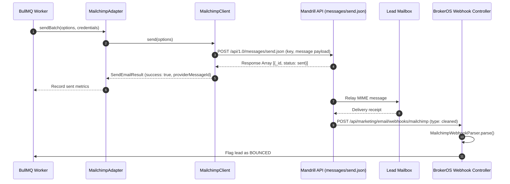

## Overview

Mailchimp (by Intuit) combines list marketing with Mandrill, its developer-focused transactional email infrastructure. In BrokerOS, the Mailchimp integration is implemented in [`integrations/mail/mailchimp/src/index.ts`](file:///c:/Users/Sumama/Desktop/enterprise-crm-realtors/integrations/mail/mailchimp/src/index.ts) under the Turborepo workspace package `@brokeros/int-mail-mailchimp`.

Administrators connect Mailchimp and Mandrill directly in the BrokerOS Web UI at **Dashboard -> Marketing -> Email -> Settings**. All API tokens are encrypted with AES-256-GCM and stored in the database (`MarketingIntegration`).

---

## Architecture and Dispatch Sequence

The Mailchimp integration implements the `IEmailMarketingProvider` contract from [`@brokeros/types`](file:///c:/Users/Sumama/Desktop/enterprise-crm-realtors/packages/types). Outbound marketing and transactional emails route directly to the Mandrill API endpoint.



---

## Step 1: Obtain Credentials from Mandrill

1. Log into your Mandrill dashboard at [mandrillapp.com](https://mandrillapp.com) (or Mailchimp Transactional via Mailchimp account settings).
2. Navigate to **Settings -> API Keys**.
3. Click **+ New API Key**, label it (e.g. `BrokerOS Production`), and copy the key string.
4. Under **Settings -> Sending Domains**, add your sending domain and verify the DNS records (DKIM and SPF TXT).
5. Identify your Mailchimp server prefix (e.g. `us1`, `us20`), visible in your Mailchimp portal URL.

---

## Step 2: Connect in the BrokerOS Web Dashboard

In your BrokerOS dashboard:

1. Navigate to **Dashboard -> Marketing -> Email -> Settings**.
2. Open the **Providers & Domains** tab (`/dashboard/marketing/email/settings?tab=providers`).
3. Click **Add Provider** and select **Mailchimp**.
4. Fill in the modal connection fields:

| UI Modal Field | Required | Description & Example |
| :--- | :--- | :--- |
| **Account Name** | Yes | Display name in BrokerOS (e.g. `Mandrill Transactional Engine`). |
| **From Name** | Yes | Default sender name (e.g. `Skyline Realty Notifications`). |
| **From Email** | Yes | Sender address on your verified domain (e.g. `newsletter@skylinerealty.com`). |
| **Mandrill API Key** | Yes | API key generated in Mandrill settings (`md-...`). |
| **Server Prefix** | Yes | Data center shard identifier (e.g. `us1` or `us20`). |
| **Set as Default** | Optional | Set this provider as primary for outbound campaigns. |

5. Click **Verify & Connect**. BrokerOS sends a live ping to `https://mandrillapp.com/api/1.0/users/ping.json` to verify the key, encrypts it with AES-256-GCM, and stores it in the database.

---

## Step 3: Register Inbound Webhook URL

To automate bounce suppression and unsubscribe management:

1. In your Mandrill portal, navigate to **Settings -> Webhooks**.
2. Click **Add a Webhook**.
3. Set the Post URL to:
   ```
   https://api.yourfirm.com/api/marketing/email/webhooks/mailchimp
   ```
4. Check the events for **Message Is Unsubscribed** and **Message Hard-Bounced (Cleaned)**.
5. Save the webhook. Incoming webhooks are parsed by `MailchimpWebhookParser` to update lead opt-in states.

---

## Webhook Telemetry Handling

| Mailchimp / Mandrill Type | BrokerOS Event Type | Meaning & CRM Action |
| :--- | :--- | :--- |
| `cleaned` | `BOUNCED` | Recipient address experienced a hard bounce; BrokerOS suppresses future sends to this email |
| `unsubscribe` | `UNSUBSCRIBED` | Contact clicked unsubscribe link; BrokerOS updates lead opt-in preferences |

---

## Integration Implementation Details

The core client logic lives in [`integrations/mail/mailchimp/src/index.ts`](file:///c:/Users/Sumama/Desktop/enterprise-crm-realtors/integrations/mail/mailchimp/src/index.ts).

### Live Validation Check

When configured in the UI, `MailchimpClient.validate()` sends a heartbeat ping to Mandrill:

```typescript
export class MailchimpClient {
  private apiKey: string;
  private server: string;

  constructor(credentials?: ProviderCredentials) {
    this.apiKey = credentials?.apiKey || process.env.MAILCHIMP_API_KEY || '';
    this.server = credentials?.mailchimpServer || process.env.MAILCHIMP_SERVER_PREFIX || 'us1';
  }

  async validate(): Promise<boolean> {
    if (!this.apiKey || this.apiKey.length < 16) return false;

    try {
      const res = await fetch('https://mandrillapp.com/api/1.0/users/ping.json', {
        method: 'POST',
        headers: { 'Content-Type': 'application/json' },
        body: JSON.stringify({ key: this.apiKey }),
      });

      if (res.status === 200) {
        const text = await res.text();
        return text.includes('PONG') || text.includes('ping');
      }
      return false;
    } catch {
      return this.apiKey.length >= 20;
    }
  }
}
```

### Outbound Payload Assembly

Campaign worker batches structure messages according to Mandrill transactional specifications:

```typescript
const payload: Record<string, any> = {
  key: this.apiKey,
  message: {
    html: options.htmlContent,
    subject: options.subject,
    from_email: options.fromEmail,
    from_name: options.fromName || undefined,
    to: options.to.map((recipient) => ({
      email: recipient.email,
      name: recipient.name || undefined,
      type: 'to',
    })),
  },
};

if (options.plainTextContent) {
  payload.message.text = options.plainTextContent;
}

if (options.replyTo) {
  payload.message.headers = { 'Reply-To': options.replyTo };
}

if (options.tracking) {
  payload.message.track_opens = Boolean(options.tracking.enableOpens);
  payload.message.track_clicks = Boolean(options.tracking.enableClicks);
  if (options.tracking.campaignId) {
    payload.message.tags = [`campaign-${options.tracking.campaignId}`];
  }
}
```
