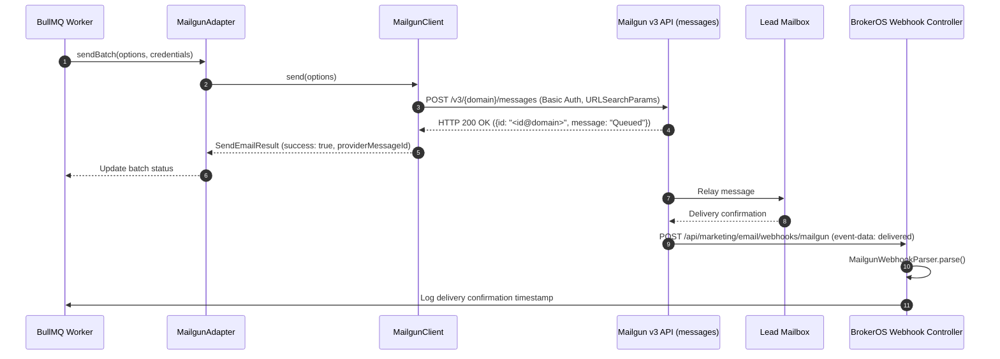

## Overview

Mailgun (by Sinch) is an enterprise developer-centric email API engineered for high-throughput transactional and broadcast delivery. In BrokerOS, the Mailgun integration lives in [`integrations/mail/mailgun/src/index.ts`](file:///c:/Users/Sumama/Desktop/enterprise-crm-realtors/integrations/mail/mailgun/src/index.ts) under the Turborepo workspace package `@brokeros/int-mail-mailgun`.

BrokerOS administrators configure Mailgun entirely within the Web UI at **Dashboard -> Marketing -> Email -> Settings**. All API credentials are encrypted with AES-256-GCM and stored in PostgreSQL (`MarketingIntegration`).

---

## Architecture and Dispatch Sequence

The Mailgun integration implements the `IEmailMarketingProvider` contract from [`@brokeros/types`](file:///c:/Users/Sumama/Desktop/enterprise-crm-realtors/packages/types). Outbound marketing and transactional emails submit form-encoded MIME requests to Mailgun's v3 endpoint.



---

## Step 1: Obtain Credentials from Mailgun

1. Log into your Mailgun dashboard at [app.mailgun.com](https://app.mailgun.com).
2. Navigate to **Sending -> Domains** and add your sending subdomain (e.g. `mail.skylinerealty.com`).
3. Add the two TXT records (SPF and DKIM `k=rsa; p=...`) and MX routing records provided by Mailgun into your DNS management console.
4. Navigate to **Settings -> API Security** and copy your primary **Private API Key** (starting with `key-`).
5. Note your account region (**US** or **EU**).

---

## Step 2: Connect in the BrokerOS Web Dashboard

In your BrokerOS dashboard:

1. Navigate to **Dashboard -> Marketing -> Email -> Settings**.
2. Select the **Providers & Domains** tab (`/dashboard/marketing/email/settings?tab=providers`).
3. Click **Add Provider** and choose **Mailgun**.
4. Fill in the modal connection fields:

| UI Modal Field | Required | Description & Example |
| :--- | :--- | :--- |
| **Account Name** | Yes | Friendly name in CRM (e.g. `Mailgun Production US`). |
| **From Name** | Yes | Display name for campaign recipients (e.g. `Skyline Realty Sales`). |
| **From Email** | Yes | Address using your configured domain (e.g. `sales@mail.skylinerealty.com`). |
| **Private API Key** | Yes | Private key starting with `key-...` from Mailgun security settings. |
| **Sending Domain** | Yes | Fully-qualified domain verified in Mailgun (e.g. `mail.skylinerealty.com`). |
| **Region** | Yes | Select `US` (`api.mailgun.net`) or `EU` (`api.eu.mailgun.net`). |
| **Set as Default** | Optional | Set this gateway as primary for campaigns. |

5. Click **Verify & Connect**. BrokerOS connects to `GET /v3/domains/{domain}`, verifies active domain status, encrypts the credentials via AES-256-GCM, and stores them in `MarketingIntegration`.

---

## Step 3: Configure Webhook Endpoints in Mailgun

To stream live bounce, open, and click metrics into BrokerOS:

1. In Mailgun, go to **Sending -> Webhooks**.
2. Add your BrokerOS webhook destination URL:
   ```
   https://api.yourfirm.com/api/marketing/email/webhooks/mailgun
   ```
3. Enable events for **Delivered Messages**, **Permanent Failure**, **Temporary Failure**, **Clicks**, **Opens**, and **Unsubscribes**.
4. Save the webhook. BrokerOS `MailgunWebhookParser` processes incoming callbacks automatically.

---

## Webhook Event Telemetry Mapping

| Mailgun Event | BrokerOS Event Type | Stored Data | Platform Action |
| :--- | :--- | :--- | :--- |
| `delivered` | `DELIVERED` | Delivery timestamp | Updates campaign delivery count |
| `opened` | `OPENED` | Client info, IP | Registers recipient open |
| `clicked` | `CLICKED` | Clicked URL, IP | Increments click count; updates lead score |
| `failed` | `BOUNCED` | Error description, reason | Flags lead as bounced; prevents subsequent sends |
| `complained` | `SPAM_COMPLAINT` | Timestamp | Blocks recipient email address |
| `unsubscribed` | `UNSUBSCRIBED` | Timestamp | Updates lead unsubscribe status |

---

## Integration Implementation Details

The Mailgun integration source code is located in [`integrations/mail/mailgun/src/index.ts`](file:///c:/Users/Sumama/Desktop/enterprise-crm-realtors/integrations/mail/mailgun/src/index.ts).

### Multi-Region Resolution

The client dynamically resolves endpoints based on tenant configuration:

```typescript
export class MailgunClient {
  private apiKey: string;
  private domain: string;
  private region: 'US' | 'EU';

  constructor(credentials?: ProviderCredentials) {
    this.apiKey = credentials?.apiKey || process.env.MAILGUN_API_KEY || '';
    this.domain = credentials?.mailgunDomain || process.env.MAILGUN_DOMAIN || '';
    this.region = (credentials?.mailgunRegion as 'US' | 'EU') || 'US';
  }

  private getBaseUrl(): string {
    return this.region === 'EU' ? 'https://api.eu.mailgun.net/v3' : 'https://api.mailgun.net/v3';
  }

  private getAuthHeader(): string {
    const auth = Buffer.from(`api:${this.apiKey}`).toString('base64');
    return `Basic ${auth}`;
  }
}
```

### Form-Encoded Dispatch

Outbound batches are encoded as `application/x-www-form-urlencoded` payloads:

```typescript
const params = new URLSearchParams();
params.append('from', `"${options.fromName}" <${options.fromEmail}>`);
recipientEmails.forEach((to) => params.append('to', to));
params.append('subject', options.subject);
params.append('html', options.htmlContent);

if (options.plainTextContent) {
  params.append('text', options.plainTextContent);
}

if (options.replyTo) {
  params.append('h:Reply-To', options.replyTo);
}

if (options.tracking) {
  params.append('o:tracking', 'yes');
  params.append('o:tracking-clicks', options.tracking.enableClicks ? 'yes' : 'no');
  params.append('o:tracking-opens', options.tracking.enableOpens ? 'yes' : 'no');
  if (options.tracking.campaignId) {
    params.append('v:campaignId', options.tracking.campaignId);
  }
}
```
