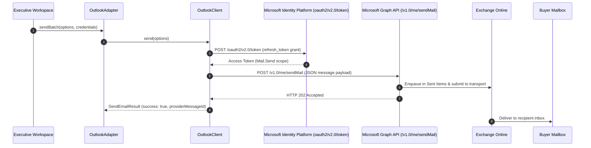

## Overview

Commercial real estate brokerages running on the Microsoft 365 enterprise ecosystem rely on Microsoft Graph for authenticated corporate messaging. In BrokerOS, the Microsoft 365 and Outlook integration lives in [`integrations/mail/outlook/src/index.ts`](file:///c:/Users/Sumama/Desktop/enterprise-crm-realtors/integrations/mail/outlook/src/index.ts) under the Turborepo workspace package `@brokeros/int-mail-outlook`.

BrokerOS administrators configure Outlook accounts directly in the Web UI at **Dashboard -> Marketing -> Email -> Settings**. Credentials and refresh tokens are encrypted with AES-256-GCM and stored in the database (`MarketingIntegration`).

---

## Architecture and Dispatch Sequence

The Outlook integration implements the `IEmailMarketingProvider` contract from [`@brokeros/types`](file:///c:/Users/Sumama/Desktop/enterprise-crm-realtors/packages/types). It communicates directly with Microsoft Graph API v1.0.



---

## Step 1: Obtain Credentials from Microsoft Azure Portal

1. Log into the [Microsoft Entra Admin Center](https://entra.microsoft.com) or [Azure Portal](https://portal.azure.com).
2. Navigate to **Identity -> Applications -> App registrations** and click **New registration**.
3. Name your application (e.g. `BrokerOS CRM Mail`).
4. Note your **Application (Client) ID** and **Directory (Tenant) ID**.
5. Under **Certificates & secrets**, create a new client secret and copy its value.
6. Under **API permissions**, add delegated Microsoft Graph permissions for `Mail.Send`, `Mail.ReadWrite`, and `offline_access`.

---

## Step 2: Connect in the BrokerOS Web Dashboard

In your BrokerOS dashboard:

1. Navigate to **Dashboard -> Marketing -> Email -> Settings**.
2. Select the **Providers & Domains** tab (`/dashboard/marketing/email/settings?tab=providers`).
3. Click **Add Provider** and select **Microsoft 365 (Outlook)**.
4. Fill in the modal connection fields:

| UI Modal Field | Required | Description & Example |
| :--- | :--- | :--- |
| **Account Name** | Yes | Friendly label in CRM (e.g. `Corporate Exchange Mailbox`). |
| **From Name** | Yes | Executive's full name (e.g. `Vikram Singhania`). |
| **From Email** | Yes | Corporate address (e.g. `vikram@skylinerealty.com`). |
| **Tenant ID** | Yes | Microsoft Entra Directory ID (or `common`). |
| **Client ID** | Yes | Application ID registered in Azure Portal. |
| **Client Secret** | Yes | Active client secret generated in Azure. |
| **OAuth Refresh Token** | Yes | Offline token authorizing Graph API operations. |

5. Click **Verify & Connect**. BrokerOS tests token renewal against Microsoft's OAuth endpoint, encrypts the secrets with AES-256-GCM, and saves them in `MarketingIntegration`.

---

## Integration Implementation Details

The Outlook integration source code is located in [`integrations/mail/outlook/src/index.ts`](file:///c:/Users/Sumama/Desktop/enterprise-crm-realtors/integrations/mail/outlook/src/index.ts).

### OAuth Token Refresh

Before dispatching emails, the client renews the access token:

```typescript
private async getAccessToken(): Promise<string | null> {
  if (!this.refreshToken || !this.clientId || !this.clientSecret) {
    return null;
  }

  try {
    const res = await fetch(`https://login.microsoftonline.com/${this.tenantId}/oauth2/v2.0/token`, {
      method: 'POST',
      headers: { 'Content-Type': 'application/x-www-form-urlencoded' },
      body: new URLSearchParams({
        client_id: this.clientId,
        client_secret: this.clientSecret,
        refresh_token: this.refreshToken,
        grant_type: 'refresh_token',
        scope: 'https://graph.microsoft.com/Mail.Send https://graph.microsoft.com/Mail.ReadWrite offline_access',
      }).toString(),
    });

    if (!res.ok) return null;
    const data: any = await res.json().catch(() => ({}));
    return data?.access_token || null;
  } catch {
    return null;
  }
}
```

### Graph SendMail API Dispatch

Emails are formatted into Microsoft Graph JSON and posted to `/v1.0/me/sendMail`:

```typescript
const payload: any = {
  message: {
    subject: options.subject,
    body: {
      contentType: 'HTML',
      content: options.htmlContent,
    },
    toRecipients: options.to.map((t) => ({
      emailAddress: { address: t.email, name: t.name || t.email.split('@')[0] },
    })),
    from: {
      emailAddress: { address: options.fromEmail, name: options.fromName },
    },
  },
  saveToSentItems: 'true',
};

const res = await fetch('https://graph.microsoft.com/v1.0/me/sendMail', {
  method: 'POST',
  headers: {
    Authorization: `Bearer ${token}`,
    'Content-Type': 'application/json',
  },
  body: JSON.stringify(payload),
});
```
