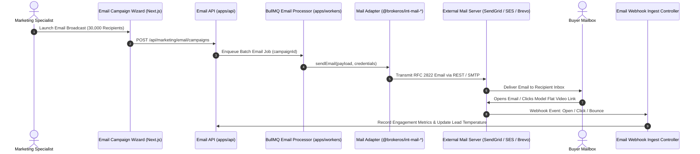

BrokerOS connects to 8 enterprise email delivery providers. Rather than routing all communications through a single shared server, BrokerOS maintains self-contained, typed packages in `integrations/mail/` (`@brokeros/int-mail-*`).

This architecture empowers brokerages to segment marketing broadcasts (via AWS SES, SendGrid, or Brevo) from personal sales executive outreach and site visit invitations (via Google Workspace Gmail and Microsoft 365 Outlook).

---

## Outbound Email Dispatch Pipeline



---

## The `IEmailMarketingProvider` Contract

Every email adapter inside `integrations/mail/` implements the standard TypeScript interface defined in `@brokeros/types`:

```typescript
export interface IEmailMarketingProvider {
  readonly providerType: EmailProviderType;
  
  // Validates API credentials and checks account status
  validate(credentials?: ProviderCredentials): Promise<boolean>;
  
  // Discovers verified sender domains and email identities
  listSenderIdentities(credentials?: ProviderCredentials): Promise<DiscoveredSenderIdentity[]>;
  
  // Checks SPF, DKIM, and MX DNS verification status
  verifySenderIdentity(identity: string, credentials?: ProviderCredentials): Promise<SenderIdentityVerificationResult>;
  
  // Transmits an HTML or plain-text email with tracking headers
  sendEmail(options: SendEmailOptions, credentials?: ProviderCredentials): Promise<SendEmailResult>;
  
  // Parses delivery, bounce, open, click, and complaint webhooks
  parseDeliveryWebhook(headers: Record<string, any>, body: any): EmailWebhookEvent[];
  
  // Parses inbound customer email replies for the Team Inbox
  parseInboundWebhook?(headers: Record<string, any>, body: any): InboundEmailPayload | null;
}
```

---

## Supported Email Provider Packages

| Email Provider | Monorepo Package | Ideal Real Estate Use Case | Delivery Protocol |
| :--- | :--- | :--- | :--- |
| **AWS SES** | `@brokeros/int-mail-ses` | Mass bulk broadcasts (hundreds of thousands of leads) at minimum cost. | AWS REST API (SigV4) |
| **SendGrid** | `@brokeros/int-mail-sendgrid` | Targeted marketing newsletters with dedicated IP warmup pools. | SendGrid v3 Mail Send API |
| **Brevo** | `@brokeros/int-mail-brevo` | Combined European real estate marketing with GDPR compliance. | Brevo v3 Transactional API |
| **Mailchimp** | `@brokeros/int-mail-mailchimp` | High-fidelity visual marketing with Mandrill transactional delivery. | Mandrill Messages API |
| **Mailgun** | `@brokeros/int-mail-mailgun` | Detailed deliverability telemetry and inbound RFC 2822 parsing. | Mailgun v3 Messages API |
| **Gmail** | `@brokeros/int-mail-gmail` | 1-on-1 personal sales consultation from `agent@brokerage.com`. | Google Workspace OAuth / REST |
| **Outlook** | `@brokeros/int-mail-outlook` | Enterprise sales emails and calendar invitations via Microsoft 365. | Microsoft Graph API v1.0 |
| **Constant Contact** | `@brokeros/int-mail-constant-contact` | Relationship nurturing with automated list synchronization. | Constant Contact v3 API |

---

## Domain Authentication & DNS Hygiene

To maximize inbox placement and prevent messages from landing in spam folders, BrokerOS requires sending domains to pass three cryptographic DNS verification checks:

1. **SPF (Sender Policy Framework)**: A TXT record identifying authorized IP addresses and mail servers allowed to send mail on behalf of your domain.
2. **DKIM (DomainKeys Identified Mail)**: CNAME or TXT records containing public cryptographic keys used to verify that message bodies were not altered in transit.
3. **DMARC (Domain-based Message Authentication)**: A policy TXT record at `_dmarc.yourdomain.com` instructing receiving mail transfer agents (such as Gmail and Yahoo) on how to handle failed SPF or DKIM checks.

You can verify these records interactively by clicking **Verify Domain** in **Settings -> Integrations -> Email -> Domain Verification**.

---

## Setting Up an Email Provider

1. In the BrokerOS dashboard, navigate to **Dashboard -> Marketing -> Email -> Settings -> Provider Integrations**.
2. Click **Add Email Provider** and choose your desired service.
3. Enter your API credentials (API key, AWS IAM keys, or OAuth credentials).
4. Enter your corporate sending domain (e.g., `updates.skylinerealty.com`).
5. Configure your DNS records using the generated SPF, DKIM, and DMARC instructions.
6. Click **Verify DNS**: Once DNS records propagate, BrokerOS marks the identity as verified and enables it for campaigns.
