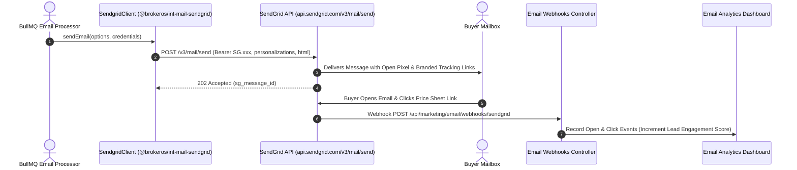

**Twilio SendGrid** is the industry standard for transactional and marketing email delivery, processing over 100 billion emails monthly. For real estate brokerages running VIP investor newsletters, automated drip sequences, and broker network updates, SendGrid provides high inbox placement rates, dedicated IP warmup management, and granular event webhooks.

The BrokerOS integration (`@brokeros/int-mail-sendgrid`) connects directly to the SendGrid v3 Mail Send API.

---

## SendGrid Email Pipeline



---

## Required Credentials

To connect SendGrid to BrokerOS, generate an API Key in the [SendGrid App Dashboard](https://app.sendgrid.com):

| Credential Field | Parameter in BrokerOS | Requirements & Format |
| :--- | :--- | :--- |
| **API Key** | `API Key` | Secret API Key starting with `SG.` (e.g., `SG.8fK9...`). |
| **Sending Domain** | `Sending Domain` | Authenticated sending domain (e.g., `mail.skylinerealty.com`). |
| **From Email** | `From Email` | Verified Sender Identity (e.g., `vip@skylinerealty.com`). |

---

## Configuration Steps

<Steps>
  <Step title="Create API Key in SendGrid">
    Log in to `app.sendgrid.com`. Navigate to **Settings -> API Keys**. Create an API Key with **Full Access** or restricted **Mail Send** permissions. Copy the key starting with `SG.`.
  </Step>

  <Step title="Authenticate Your Sending Domain">
    Under **Settings -> Sender Authentication -> Authenticate Your Domain**, choose your DNS provider (Cloudflare, GoDaddy, AWS Route 53). Add the 3 CNAME DNS records provided by SendGrid to prove domain ownership.
  </Step>

  <Step title="Add SendGrid in BrokerOS Settings">
    In the BrokerOS dashboard:
    1. Navigate to **Dashboard -> Marketing -> Email -> Settings**.
    2. Select the **Providers & Domains** tab (`/dashboard/marketing/email/settings?tab=providers`).
    3. Click **Add Provider** and choose **SendGrid**.
    4. Fill in the modal fields: **Account Name**, **From Name**, **From Email**, and **API Key** (`SG....`).
    5. Click **Verify & Connect**: BrokerOS tests credentials against `https://api.sendgrid.com/v3/user/profile`, validates domain authentication, encrypts credentials via AES-256-GCM, and saves them to `MarketingIntegration`.
  </Step>

  <Step title="Configure SendGrid Event Webhook">
    In the SendGrid Dashboard under **Settings -> Mail Settings -> Event Webhook**, set the **HTTP Post URL** to:
    ```
    https://api.yourdomain.com/api/marketing/email/webhooks/sendgrid
    ```
    Enable event notifications for: **Delivered**, **Bounced**, **Opened**, **Clicked**, and **Spam Reports**.
  </Step>
</Steps>
