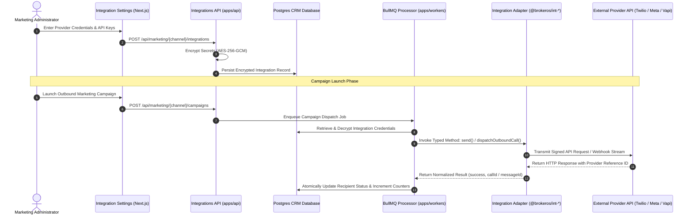

BrokerOS does not lock your brokerage into a single vendor for voice calling, messaging, or artificial intelligence. Instead, it operates a modular integration layer that connects your CRM directly to best-in-class external communication service providers.

All third-party adapters live in dedicated workspace packages under `integrations/`, strictly decoupled from application database queries and business logic.

---

## The 5 Integration Channels

<CardGroup cols={2}>
  <Card title="Phone Carriers (PSTN)" icon="phone-volume" href="/integrations/telephony/overview">
    Connect **Vobiz**, **Exotel**, **Twilio**, or **Telnyx** to place live telephone calls for autonomous AI voice campaigns and mobile auto-dialers.
  </Card>
  <Card title="AI Voice Platforms" icon="robot" href="/integrations/voice/vapi">
    Connect **Vapi**, **Retell AI**, **ElevenLabs**, **Sarvam AI**, **Bolna**, **LiveKit**, **OpenAI Realtime**, or **Pipecat** as the conversational intelligence engine.
  </Card>
  <Card title="WhatsApp (Meta Cloud API)" icon="whatsapp" href="/integrations/whatsapp/meta-cloud-api">
    Direct integration with the Meta WhatsApp Cloud API for official template broadcasts, interactive quick-reply buttons, and team inbox dialogues.
  </Card>
  <Card title="SMS Gateways" icon="message-sms" href="/integrations/sms/overview">
    Connect **Twilio**, **Gupshup**, **Sinch**, **AWS SNS**, **Plivo**, **Telnyx**, **Vonage**, **Infobip**, or **Bird** for high-throughput promotional SMS and two-way conversations.
  </Card>
  <Card title="Email Service Providers" icon="envelope" href="/integrations/mail/overview">
    Connect **AWS SES**, **SendGrid**, **Brevo**, **Mailchimp**, **Mailgun**, **Gmail**, **Outlook**, or **Constant Contact** for bulk broadcasts and direct threaded email management.
  </Card>
</CardGroup>

---

## Architectural Dispatch Flow

Every integration channel follows an asynchronous, audited dispatch lifecycle that isolates external network calls from the main NestJS API request thread:

---

## Integration Governance Laws

The BrokerOS monorepo enforces strict architectural laws across all packages in `integrations/`:

### 1. In-App UI Configuration & Zero Credential Hardcoding
Never embed tokens, API keys, client secrets, or webhook signing keys inside application source code. Administrators configure credentials directly within the BrokerOS web UI under **Dashboard -> Marketing -> [Channel] -> Settings**. Credentials are encrypted using AES-256-GCM and stored in PostgreSQL (`MarketingIntegration`, `SmsIntegration`, `VoiceTelephonyIntegration`, `VoiceAgentIntegration`). Adapters receive credentials dynamically via configuration objects passed from the caller (`apps/api` or `apps/workers`). The repository root `.env` serves strictly as an optional developer fallback during local testing.

### 2. Adapter Purity (No Database Access)
Adapters only handle request preparation, HTTP transport, retries, timeouts, cryptographic signing, error normalization, and response parsing. Never import database models or `@brokeros/prisma` inside `integrations/`.

### 3. No Direct External Calls from Applications
Application modules (`apps/api` and `apps/workers`) must never make raw `fetch()` or `axios` calls directly to external SaaS providers. All external calls must route through typed functions exported from `@brokeros/int-*` workspace packages.

### 4. Standard Adapter Interface Contract
Every delivery adapter implements a consistent TypeScript interface:
- `send(payload, credentials)`: Transmits the message or call and returns a normalized result.
- `validateConfig(credentials)`: Verifies that API keys or SIP parameters are valid before saving.
- `verifyWebhookSignature(headers, body, secret)`: Validates incoming webhook authenticity using HMAC signatures.

---

## Security Model: Storage & Webhook Verification

BrokerOS protects third-party credentials and communication channels using enterprise cryptographic standards:

- **At-Rest Secret Encryption**: All sensitive credentials (API tokens, Twilio Auth Tokens, Exotel keys, Meta access tokens, and SIP passwords) are encrypted using **AES-256-GCM** with a dynamic initialization vector (IV) before persistence.
- **In-Transit Webhook Integrity**: Inbound callbacks from external providers are cryptographically validated using **HMAC-SHA256** signatures (such as Meta `X-Hub-Signature-256`, Twilio signature headers, and Retell signature tokens) to prevent payload spoofing.
- **Zero Logging Policy**: Authentication headers, raw API keys, and decrypted credentials are strictly scrubbed from application logging pipelines.

---

## Regional Selection Recommendations

| Communication Channel | Indian Domestic Operations | International / Global Operations | Selection Rationale |
| :--- | :--- | :--- | :--- |
| **Phone Carriers (PSTN)** | **Vobiz** or **Exotel** | **Twilio** or **Telnyx** | Vobiz and Exotel offer local Indian CLI presentation and low termination rates. Twilio and Telnyx offer global reach and SIP flexibility. |
| **AI Voice Brains** | **Sarvam AI** or **Bolna** | **Retell AI**, **Vapi**, or **ElevenLabs** | Sarvam and Bolna specialize in Indian regional languages (Hindi, Marathi, etc.). Retell and Vapi provide ultra-low latency conversational turn-taking. |
| **WhatsApp** | **Meta Cloud API** | **Meta Cloud API** | Official direct Meta Cloud API integration with 24-hour service messaging windows and template approval. |
| **SMS Gateways** | **Gupshup** | **Twilio** or **Sinch** | Gupshup provides built-in Indian DLT template registration compliance. Twilio provides international carrier routing. |
| **Email Services** | **AWS SES** or **SendGrid** | **AWS SES**, **SendGrid**, or **Brevo** | AWS SES delivers the lowest cost per thousand emails at scale. SendGrid provides deliverability tooling and warmup pools. |

---

## Related Documentation

- [Telephony Carriers Overview](file:///c:/Users/Sumama/Desktop/enterprise-crm-realtors/docs/integrations/telephony/overview.mdx)
- [Carrier Telephony Bridge Guide](file:///c:/Users/Sumama/Desktop/enterprise-crm-realtors/docs/marketing/voice/carrier-telephony.mdx)
- [Voice Integration Package Code](file:///c:/Users/Sumama/Desktop/enterprise-crm-realtors/integrations/voice/)
- [Central Carrier Bridge Dispatcher](file:///c:/Users/Sumama/Desktop/enterprise-crm-realtors/integrations/voice/bridge/carrier-bridge-dispatcher.ts)
