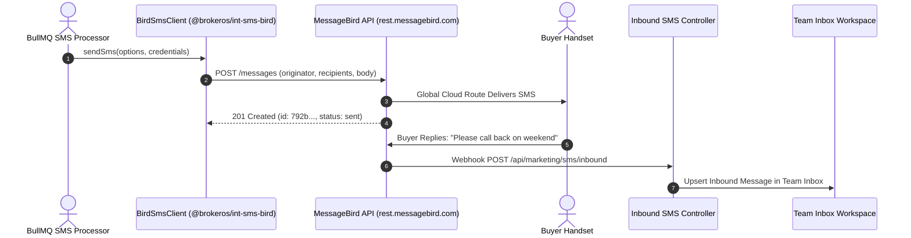

**Bird** (formerly MessageBird) is a cloud-native telecommunications platform offering intelligent global routing and SMS delivery across 200+ countries. In BrokerOS, the Bird integration (`@brokeros/int-sms-bird`) connects to the MessageBird REST API using AccessKey authentication.

---

## Bird SMS Pipeline

---

## Required Credentials

To connect Bird, obtain your live API key from the [Bird Portal](https://dashboard.messagebird.com):

| Credential Field | Parameter in BrokerOS Modal | Requirements & Format |
| :--- | :--- | :--- |
| **Live Access Key** | `Bird / MessageBird Live Access Key` | Live API Access Key from Bird Developer console. |
| **From Sender** | `Default From Sender / Header` | Verified international virtual number or approved originator. |
| **API Endpoint** | `API Endpoint URL (Optional)` | Default `https://rest.messagebird.com` or custom proxy endpoint. |

---

## Configuration Steps

<Steps>
  <Step title="Retrieve Live Access Key from Bird">
    Log in to `dashboard.messagebird.com`. Navigate to **Developers -> API Access** and copy your **Live API AccessKey**.
  </Step>

  <Step title="Add Bird in BrokerOS Settings">
    In the BrokerOS web application:
    1. Navigate to **Dashboard -> Marketing -> SMS -> Settings -> Gateways & Phone Pools** tab (`/dashboard/marketing/sms/settings?tab=providers`).
    2. Click **Connect Gateway** (or select **BIRD** from the available gateways list).
    3. In the **Connect Bird** modal, configure the parameters:
       - **Account Nickname**: A descriptive label (e.g., `Bird Global SMS Gateway`).
       - **Default From Sender / Header**: Your verified virtual number in E.164 format or approved originator header.
       - **Bird / MessageBird Live Access Key**: Your live access key from the Bird Developer console.
       - **API Endpoint URL (Optional)**: Custom endpoint if routing via dedicated proxy, or leave blank for default.
       - **Set as default gateway for SMS broadcasts**: Toggle on if Bird is your primary SMS route.
    4. Click **Verify & Save Credentials**. BrokerOS queries `https://rest.messagebird.com/balance` to confirm balance and status, encrypts secrets with AES-256-GCM, and persists the configuration to PostgreSQL (`SmsIntegration`).
  </Step>

  <Step title="Configure Webhook Forwarding">
    In the Bird Dashboard under **SMS Settings -> Webhooks**, configure:
    - **Status Reports**: `https://api.yourdomain.com/api/marketing/sms/webhooks/bird`
    - **Inbound SMS**: `https://api.yourdomain.com/api/marketing/sms/inbound`
  </Step>
</Steps>
