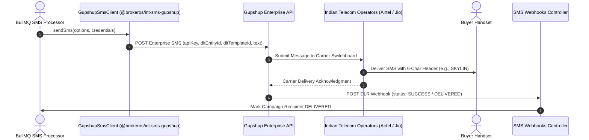

**Gupshup** is India's premier enterprise messaging platform, providing direct routing to all major Indian Mobile Network Operators (Airtel, Reliance Jio, Vodafone Idea, and BSNL). The BrokerOS Gupshup integration (`@brokeros/int-sms-gupshup`) provides native support for Principal Entity IDs, 6-character alphabetic sender headers, approved DLT Content Template IDs, and real-time Delivery Receipt (DLR) status callbacks.

---

## Gupshup SMS Pipeline

---

## Required Credentials

To connect Gupshup to BrokerOS, obtain the following credentials from your Gupshup Enterprise portal:

| Credential Field | Parameter in BrokerOS | Description & Example |
| :--- | :--- | :--- |
| **API Key** | `API Key` | Enterprise REST API Key (found under API Settings). |
| **DLT Entity ID** | `DLT Entity ID` | Your registered Principal Entity ID (e.g., `11015893200000...`). |
| **Sender ID / Header** | `Sender ID` | Approved 6-character uppercase alphabetic header (e.g., `SKYLIN`). |

---

## Configuration Steps

<Steps>
  <Step title="Register on the Operator DLT Portal">
    Register your real estate brokerage on an Indian telecom operator DLT portal (such as Airtel DLT or Jio DLT) to obtain your **Principal Entity ID**.
  </Step>

  <Step title="Register Your 6-Character Sender Header">
    In your DLT portal and Gupshup dashboard, submit your 6-character sender name (e.g., `SKYLIN` or `BRKROS`) under the **Promotional** or **Service Implicit/Explicit** category.
  </Step>

  <Step title="Register Content Templates">
    Submit each SMS message template on the DLT portal with dynamic variables formatted as `{#var#}`. Once approved, note down the generated numeric **Content Template ID**.
  </Step>

  <Step title="Add Gupshup in BrokerOS Settings">
    In the BrokerOS dashboard:
    1. Navigate to **Dashboard -> Marketing -> SMS -> Settings**.
    2. Select the **Gateways & Phone Pools** tab (`/dashboard/marketing/sms/settings?tab=providers`).
    3. Click on **Gupshup** from the available gateways catalog.
    4. Fill in the modal fields: **Gateway Name** (e.g. `Gupshup India Enterprise`), **From Sender** (your approved 6-character header like `SKYLIN`), **API Key**, and **DLT Entity ID**.
    5. Click **Connect Gateway**. BrokerOS encrypts the credentials using AES-256-GCM and stores them in `SmsIntegration`.
  </Step>

  <Step title="Link DLT Template IDs in BrokerOS Template Registry">
    When configuring templates in the **BrokerOS SMS Template Registry** (`/dashboard/marketing/sms/templates`), paste the matching **DLT Template ID**. BrokerOS transmits this ID with every API request to prevent carrier rejection.
  </Step>
</Steps>

---

## Delivery Receipt (DLR) Webhook Integration

Gupshup transmits real-time delivery receipts to BrokerOS via HTTP POST:

- **Webhook Route**: `https://api.yourdomain.com/api/marketing/sms/webhooks/gupshup`
- **Supported DLR Statuses**: `SUCCESS`, `DELIVERED`, `FAILED`, `REJECTED`, and `UNDELIVERED`.
- BrokerOS automatically parses `GupshupDlrPayload` and records delivery timestamps, carrier reject codes, and recipient status updates.
