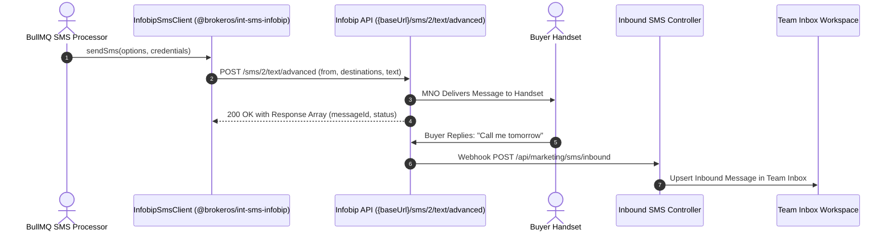

**Infobip** is an international omnichannel communications provider with direct mobile operator connections across Europe, Africa, Latin America, and the Gulf Cooperation Council (GCC) region. The BrokerOS Infobip integration (`@brokeros/int-sms-infobip`) communicates via Infobip SMS Advanced REST APIs using dedicated tenant base URLs and API Keys.

---

## Infobip SMS Pipeline

---

## Required Credentials

To connect Infobip, retrieve the following credentials from your [Infobip Portal](https://portal.infobip.com):

| Credential Field | Parameter in BrokerOS Modal | Requirements & Format |
| :--- | :--- | :--- |
| **Base URL** | `Infobip Base URL / API Domain` | Your tenant-specific base URL (e.g., `https://xxxxxx.api.infobip.com`). |
| **API Key** | `Infobip API Key` | Secret API Key string (`App xxxxxxxxxxxxxxxxxxxxxxxxxxxxxxxx`). |
| **From Sender** | `Default From Sender / Header` | Approved alphanumeric sender header or virtual number. |
| **DLT Entity ID** | `DLT Principal Entity ID (Optional)` | (Optional) 19-digit DLT PE ID for India carrier routing. |

---

## Configuration Steps

<Steps>
  <Step title="Retrieve API Key and Base URL">
    Log in to `portal.infobip.com`. On your dashboard homepage, copy your dedicated **Base URL** (e.g., `https://xxxxx.api.infobip.com`). Generate an active **API Key** under **Settings -> API Keys**.
  </Step>

  <Step title="Add Infobip in BrokerOS Settings">
    In the BrokerOS web application:
    1. Navigate to **Dashboard -> Marketing -> SMS -> Settings -> Gateways & Phone Pools** tab (`/dashboard/marketing/sms/settings?tab=providers`).
    2. Click **Connect Gateway** (or select **INFOBIP** from the available gateways list).
    3. In the **Connect Infobip** modal, configure the parameters:
       - **Account Nickname**: A descriptive label (e.g., `Infobip Europe / GCC Gateway`).
       - **Default From Sender / Header**: Your approved alphanumeric sender header or virtual number.
       - **Infobip Base URL / API Domain**: Your dedicated tenant endpoint (e.g., `https://2m4k1.api.infobip.com`).
       - **Infobip API Key**: Your secret API Key.
       - **DLT Principal Entity ID (Optional)**: 19-digit principal entity identifier if broadcasting to Indian mobile networks.
       - **Set as default gateway for SMS broadcasts**: Toggle on if Infobip is your primary SMS route.
    4. Click **Verify & Save Credentials**. BrokerOS tests credentials against `https://${baseUrl}/sms/1/inbox/reports`, encrypts secrets with AES-256-GCM, and persists the configuration to PostgreSQL (`SmsIntegration`).
  </Step>

  <Step title="Configure Delivery Reports and Inbound Webhooks">
    In the Infobip Portal, configure message forwarding:
    - **Delivery Reports URL**: `https://api.yourdomain.com/api/marketing/sms/webhooks/infobip`
    - **Inbound Messages URL**: `https://api.yourdomain.com/api/marketing/sms/inbound`
  </Step>
</Steps>
