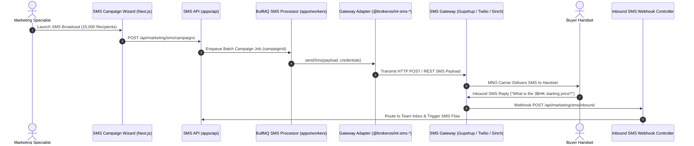

BrokerOS integrates with 9 enterprise SMS aggregators and telecom gateways. Rather than routing through third-party marketing resellers, BrokerOS communicates directly with carrier networks and aggregators via isolated, typed packages in `integrations/sms/`.

This ensures real estate brokerages maintain high delivery rates, comply with local telecom regulations (such as Indian DLT rules and US 10DLC), and support both mass promotional broadcasts and two-way sales conversations.

---

## Outbound SMS Dispatch Pipeline



---

## The `ISmsMarketingProvider` Contract

Every SMS gateway adapter inside `integrations/sms/` implements the standard TypeScript interface defined in `@brokeros/types`:

```typescript
export interface ISmsMarketingProvider {
  readonly providerType: SmsProviderType;
  
  // Validates API credentials and checks account status
  validate(credentials?: SmsProviderCredentials): Promise<boolean>;
  
  // Lists verified sender IDs, headers, and long numbers
  listSenderNumbers(credentials?: SmsProviderCredentials): Promise<DiscoveredSenderNumber[]>;
  
  // Sends a single or batched SMS message
  sendSms(options: SendSmsOptions, credentials?: SmsProviderCredentials): Promise<SendSmsResult>;
  
  // Parses delivery status reports (DLR)
  parseDeliveryWebhook(headers: Record<string, any>, body: any): SmsWebhookEvent[];
  
  // Parses two-way inbound customer replies
  parseInboundWebhook(headers: Record<string, any>, body: any): InboundSmsPayload | null;
}
```

---

## Supported SMS Gateway Packages

| Gateway | Monorepo Package | Ideal Regional Use Case | DLT / Regulatory Compliance |
| :--- | :--- | :--- | :--- |
| **Gupshup** | `@brokeros/int-sms-gupshup` | India Domestic | Native TRAI DLT header and template ID verification. |
| **Twilio** | `@brokeros/int-sms-twilio` | Global (180+ countries) | US/Canada A2P 10DLC, alphanumeric sender IDs, short codes. |
| **Sinch** | `@brokeros/int-sms-sinch` | Southeast Asia, MENA, Europe | Tier-1 direct mobile operator connections with global short codes. |
| **AWS SNS** | `@brokeros/int-sms-aws-sns` | High-Volume Cloud Scale | AWS IAM authenticated, cost-effective infrastructure. |
| **Plivo** | `@brokeros/int-sms-plivo` | US, UK, and India | Premium carrier routes with localized caller presentation. |
| **Telnyx** | `@brokeros/int-sms-telnyx` | Global IP Peering | Private IP network with wholesale messaging profile routing. |
| **Vonage** | `@brokeros/int-sms-vonage` | Global Enterprise | Adaptive Routing engine continuously bypassing telecom congestion. |
| **Infobip** | `@brokeros/int-sms-infobip` | Europe and GCC | GDPR compliant with real-time operator delivery receipts. |
| **Bird** | `@brokeros/int-sms-bird` | Global Cloud-Native | Intelligent omnichannel failover and virtual number pooling. |

---

## Character Encoding & Segment Calculation

BrokerOS automatically inspects SMS character sets to compute billing segments before transmission:

- **GSM 7-bit Encoding**: Standard alphanumeric characters. Up to 160 characters in a single message. Concatenated messages use 153 characters per segment (7 characters reserved for UDH headers).
- **UCS-2 (Unicode) Encoding**: Used when emojis, currency symbols (such as the Indian Rupee symbol `₹`), or non-Latin scripts (Hindi, Arabic, etc.) are present. Single messages are capped at 70 characters. Concatenated messages use 67 characters per segment.

The campaign pre-flight modal automatically alerts marketers if a message trips into UCS-2 encoding, preventing unexpected billing surprises.

---

## Indian Telecom DLT Compliance (TRAI Mandate)

All SMS campaigns targeting Indian mobile subscribers must comply with the Telecom Regulatory Authority of India (TRAI) Distributed Ledger Technology (DLT) framework:

1. **Entity Registration**: Register your brokerage business on a telecom DLT portal (such as Airtel, Jio, or Vodafone Idea) to receive an Enterprise Entity ID (`dltEntityId`).
2. **Sender Header Registration**: Register a 6-character alphabetic header (e.g., `SKYLIN` or `BRKROS`).
3. **Content Template Registration**: Pre-register marketing and transactional message text with dynamic variable syntax `{#var#}` to receive a Content Template ID (`dltTemplateId`).
4. **Execution in BrokerOS**: Configure your Entity ID and Template ID in the **SMS Template Registry** (`/dashboard/marketing/sms/templates`). Messages dispatched without an approved DLT template ID are automatically rejected by Indian telecom switchboards.

---

## Setting Up an SMS Gateway

1. In the BrokerOS dashboard, navigate to **Dashboard -> Marketing -> SMS -> Settings -> Gateway Integrations**.
2. Click **Add SMS Gateway** and select your desired provider.
3. Enter your API credentials (API key, Account SID, or secret token).
4. Configure your primary **Sender ID** or **Virtual Long Number**.
5. Click **Verify Gateway**: BrokerOS performs an automated API handshake and confirms active status.
6. The verified gateway becomes instantly selectable in the **Campaign Wizard** and **SMS Flows Builder**.
