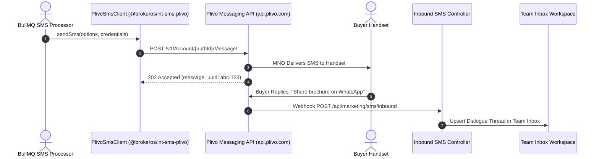

**Plivo** is a global cloud communications platform delivering direct connectivity across 190+ countries. The BrokerOS Plivo integration (`@brokeros/int-sms-plivo`) provides high-throughput messaging, automated sender ID handling, delivery status tracking, and two-way SMS synchronization.

---

## Plivo SMS Pipeline

---

## Required Credentials

To connect Plivo to BrokerOS, retrieve the following credentials from your [Plivo Console](https://console.plivo.com):

| Credential Field | Parameter in BrokerOS Modal | Requirements & Format |
| :--- | :--- | :--- |
| **Auth ID** | `Plivo Auth ID` | Plivo account identification string (e.g., `MAMTE0ODG3NG...`). |
| **Auth Token** | `Plivo Auth Token` | Primary secret API authentication token. |
| **From Sender** | `Default From Sender / Header` | Verified Plivo phone number in E.164 format or approved sender ID. |

---

## Configuration Steps

<Steps>
  <Step title="Retrieve Credentials from Plivo Console">
    Log in to `console.plivo.com`. On the main dashboard overview, copy your **Auth ID** and **Auth Token**.
  </Step>

  <Step title="Provision a Virtual Phone Number">
    Under **Phone Numbers -> Buy Numbers**, purchase an active SMS-enabled virtual long code matching your target campaign market.
  </Step>

  <Step title="Add Plivo in BrokerOS Settings">
    In the BrokerOS web application:
    1. Navigate to **Dashboard -> Marketing -> SMS -> Settings -> Gateways & Phone Pools** tab (`/dashboard/marketing/sms/settings?tab=providers`).
    2. Click **Connect Gateway** (or select **PLIVO** from the available gateways list).
    3. In the **Connect Plivo** modal, configure the parameters:
       - **Account Nickname**: A descriptive label (e.g., `Plivo Global Gateway`).
       - **Default From Sender / Header**: Your verified Plivo phone number in E.164 format (e.g., `+12025550123`) or registered sender ID.
       - **Plivo Auth ID**: Your Plivo account auth ID (`MAMTE0ODG3NG...`).
       - **Plivo Auth Token**: Your primary secret API authentication token.
       - **Set as default gateway for SMS broadcasts**: Toggle on if Plivo is your primary SMS route.
    4. Click **Verify & Save Credentials**. BrokerOS queries `https://api.plivo.com/v1/Account/{authId}/` to test credentials, encrypts secrets with AES-256-GCM, and persists the configuration to PostgreSQL (`SmsIntegration`).
  </Step>

  <Step title="Configure Delivery & Inbound Webhooks">
    In the Plivo Console, set the message callback URLs:
    - **Status Callback URL**: `https://api.yourdomain.com/api/marketing/sms/webhooks/plivo`
    - **Inbound Message URL**: `https://api.yourdomain.com/api/marketing/sms/inbound`
  </Step>
</Steps>
