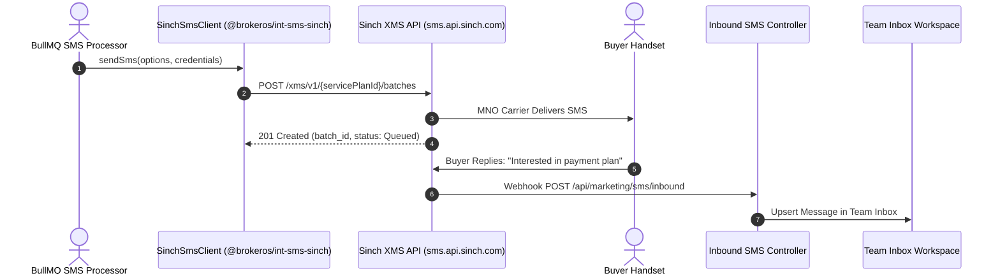

**Sinch** is a global enterprise cloud communications platform with Tier-1 direct mobile operator connections across Europe, the Middle East, Southeast Asia, and the Americas. The BrokerOS Sinch integration (`@brokeros/int-sms-sinch`) connects to Sinch SMS REST APIs (XMS v1) using Service Plan IDs and API Tokens.

---

## Sinch SMS Pipeline



---

## Required Credentials

To connect Sinch to BrokerOS, obtain the following credentials from the [Sinch Customer Dashboard](https://dashboard.sinch.com):

| Credential Field | Parameter in BrokerOS | Requirements & Format |
| :--- | :--- | :--- |
| **Service Plan ID** | `Service Plan ID` | Unique 32-character service plan string (e.g., `e8a09...`). |
| **API Token** | `API Key` | Secret API Bearer Token generated for your service plan. |
| **Virtual Number / Short Code** | `From Numbers` | Verified Sinch virtual long number or alphanumeric sender ID. |

---

## Configuration Steps

<Steps>
  <Step title="Retrieve Service Plan & API Token from Sinch">
    Log in to `dashboard.sinch.com`. Navigate to **SMS -> Service Plans**. Copy your **Service Plan ID** and generate an active **API Token**.
  </Step>

  <Step title="Add Sinch in BrokerOS Settings">
    In the BrokerOS dashboard:
    1. Navigate to **Dashboard -> Marketing -> SMS -> Settings**.
    2. Select the **Gateways & Phone Pools** tab (`/dashboard/marketing/sms/settings?tab=providers`).
    3. Click on **Sinch** from the available gateways catalog.
    4. Fill in the modal fields: **Gateway Name** (e.g. `Sinch Enterprise SMS`), **From Sender** (your virtual number or short code), **Service Plan ID**, and **API Key** (your API Token).
    5. Click **Connect Gateway**. BrokerOS tests credentials against `https://sms.api.sinch.com/xms/v1/${servicePlanId}/inbounds`, encrypts credentials via AES-256-GCM, and saves them in `SmsIntegration`.
  </Step>

  <Step title="Configure Delivery Report Callbacks">
    In the Sinch Dashboard under your Service Plan settings, set the **Delivery Report Callback URL** to:
    ```
    https://api.yourdomain.com/api/marketing/sms/webhooks/sinch
    ```
  </Step>
</Steps>
