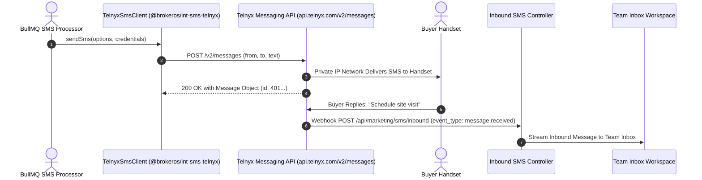

**Telnyx** provides carrier-grade global cloud messaging built upon its private international fiber-optic backbone. The BrokerOS Telnyx SMS integration (`@brokeros/int-sms-telnyx`) leverages Telnyx Messaging v2 APIs to deliver high-concurrency SMS delivery with low network latency and wholesale per-segment pricing.

---

## Telnyx SMS Pipeline



---

## Required Credentials

To connect Telnyx to BrokerOS, obtain the following credentials from your [Telnyx Mission Control Portal](https://portal.telnyx.com):

| Credential Field | Parameter in BrokerOS Modal | Requirements & Format |
| :--- | :--- | :--- |
| **API Key** | `Telnyx API Key (v2)` | V2 API Key starting with `KEY...` (found under API Keys). |
| **Messaging Profile ID** | `Messaging Profile ID (Optional)` | Profile UUID associated with your phone numbers. |
| **Sender Number** | `Default From Sender / Header` | Verified Telnyx telephone number in E.164 format (e.g., `+18005550199`). |

---

## Configuration Steps

<Steps>
  <Step title="Generate V2 API Key in Telnyx">
    Log in to `portal.telnyx.com`. Under **API Keys**, generate a new V2 API Key.
  </Step>

  <Step title="Provision a Messaging Profile">
    In the Telnyx Portal, navigate to **Messaging -> Programmable Messaging**. Create a new Messaging Profile and assign your active phone numbers to it.
  </Step>

  <Step title="Add Telnyx in BrokerOS Settings">
    In the BrokerOS web application:
    1. Navigate to **Dashboard -> Marketing -> SMS -> Settings -> Gateways & Phone Pools** tab (`/dashboard/marketing/sms/settings?tab=providers`).
    2. Click **Connect Gateway** (or select **TELNYX** from the available gateways list).
    3. In the **Connect Telnyx** modal, configure the parameters:
       - **Account Nickname**: A descriptive label (e.g., `Telnyx US Gateway`).
       - **Default From Sender / Header**: Your verified Telnyx telephone number in E.164 format (`+18005550199`).
       - **Telnyx API Key (v2)**: Your Telnyx API key starting with `KEY...`.
       - **Messaging Profile ID (Optional)**: Telnyx profile UUID linked to your telephone numbers.
       - **Set as default gateway for SMS broadcasts**: Toggle on if Telnyx is your primary SMS route.
    4. Click **Verify & Save Credentials**. BrokerOS tests credentials against `https://api.telnyx.com/v2/balance` to confirm account status, encrypts secrets with AES-256-GCM, and persists the configuration to PostgreSQL (`SmsIntegration`).
  </Step>

  <Step title="Configure Webhook Destination">
    In the Telnyx Messaging Profile settings, set the **Webhook URL** to:
    ```
    https://api.yourdomain.com/api/marketing/sms/webhooks/telnyx
    ```
    Select API Version `2`. Telnyx will now transmit `message.finalized` and `message.received` events directly to BrokerOS.
  </Step>
</Steps>
