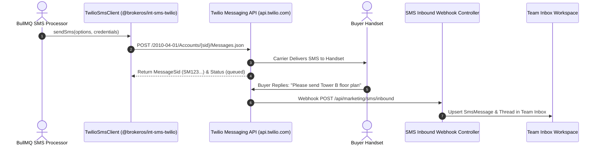

**Twilio** provides enterprise cloud messaging across 180+ countries. For international property campaigns targeting buyers across North America, the Middle East, Southeast Asia, and Europe, Twilio provides reliable carrier routing, automated short-code and long-code pooling, and full two-way customer dialogue synchronization.

The BrokerOS integration (`@brokeros/int-sms-twilio`) connects to Twilio Programmable Messaging and supports both direct virtual numbers and Messaging Services (Copilot).

---

## Twilio SMS Pipeline



---

## Required Credentials

To connect Twilio, retrieve the following credentials from your [Twilio Console](https://console.twilio.com):

| Credential Field | Parameter in BrokerOS | Requirements & Format |
| :--- | :--- | :--- |
| **Account SID** | `Account SID` | String starting with `AC` (exactly 34 characters). |
| **Auth Token** | `Auth Token` | Primary API authentication secret (32+ characters). |
| **From Number** | `From Numbers` | Verified Twilio telephone number in E.164 format (e.g., `+14155550199`). |
| **Messaging Service SID** | `Messaging Service SID` | (Optional) String starting with `MG...` for automated sender pooling. |

---

## Configuration Steps

<Steps>
  <Step title="Retrieve Credentials from Twilio Console">
    Open the [Twilio Console](https://console.twilio.com). Under **Account Info**, copy your **Account SID** and **Auth Token**.
  </Step>

  <Step title="Configure a Phone Number or Messaging Service">
    Navigate to **Messaging -> Services** to configure an intelligent Copilot sender pool, or purchase an active SMS-enabled virtual long code under **Phone Numbers -> Manage -> Buy a Number**.
  </Step>

  <Step title="Add Twilio in BrokerOS Settings">
    In the BrokerOS dashboard:
    1. Navigate to **Dashboard -> Marketing -> SMS -> Settings**.
    2. Select the **Gateways & Phone Pools** tab (`/dashboard/marketing/sms/settings?tab=providers`).
    3. Click on **Twilio** from the available gateways catalog.
    4. Fill in the modal fields: **Gateway Name** (e.g. `Twilio Global SMS`), **From Sender** (phone number in E.164 format), **Account SID**, **Auth Token**, and optional **Messaging Service SID** (`MG...`).
    5. Click **Connect Gateway**. BrokerOS tests credentials against `https://api.twilio.com/2010-04-01/Accounts/${accountSid}.json`, encrypts secrets with AES-256-GCM, and saves them in `SmsIntegration`.
  </Step>

  <Step title="Configure Inbound Webhook for 2-Way Messaging">
    In the Twilio Console under your Phone Number or Messaging Service configuration, set the **Incoming Webhook URL** to:
    ```
    https://api.yourdomain.com/api/marketing/sms/inbound
    ```
    Select `HTTP POST`. Inbound customer replies will now instantly stream into the **SMS Team Inbox**.
  </Step>
</Steps>
