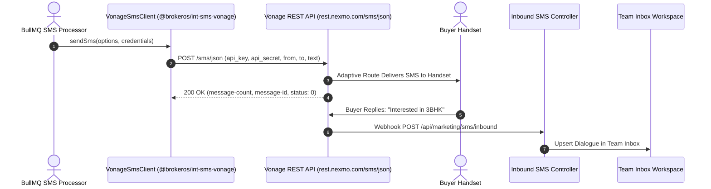

**Vonage** (formerly Nexmo) is a global telecommunications leader backed by Ericsson. In BrokerOS, the Vonage integration (`@brokeros/int-sms-vonage`) leverages Vonage's proprietary **Adaptive Routing** algorithms, continuously routing SMS messages across optimal carrier paths based on real-time delivery telemetry.

---

## Vonage SMS Pipeline

---

## Required Credentials

To connect Vonage to BrokerOS, obtain the following credentials from your [Vonage API Dashboard](https://dashboard.nexmo.com):

| Credential Field | Parameter in BrokerOS Modal | Requirements & Format |
| :--- | :--- | :--- |
| **API Key** | `Vonage API Key` | 8-character hex string (e.g., `4a8f9c2d`). |
| **API Secret** | `Vonage API Secret` | Secret alphanumeric string paired with your API key. |
| **From Sender** | `Default From Sender / Header` | Verified Vonage long code in E.164 format or approved sender ID. |

---

## Configuration Steps

<Steps>
  <Step title="Retrieve Credentials from Vonage Dashboard">
    Log in to `dashboard.nexmo.com`. On the main dashboard banner, copy your **API Key** and **API Secret**.
  </Step>

  <Step title="Add Vonage in BrokerOS Settings">
    In the BrokerOS web application:
    1. Navigate to **Dashboard -> Marketing -> SMS -> Settings -> Gateways & Phone Pools** tab (`/dashboard/marketing/sms/settings?tab=providers`).
    2. Click **Connect Gateway** (or select **VONAGE** from the available gateways list).
    3. In the **Connect Vonage** modal, configure the parameters:
       - **Account Nickname**: A descriptive label (e.g., `Vonage Global Gateway`).
       - **Default From Sender / Header**: Your verified Vonage number in E.164 format (e.g., `+12025550188`) or registered sender ID.
       - **Vonage API Key**: Your 8-character Vonage API key.
       - **Vonage API Secret**: Your secret authentication key.
       - **Set as default gateway for SMS broadcasts**: Toggle on if Vonage is your primary SMS route.
    4. Click **Verify & Save Credentials**. BrokerOS queries `https://rest.nexmo.com/account/get-balance` to validate account status, encrypts secrets with AES-256-GCM, and persists the configuration to PostgreSQL (`SmsIntegration`).
  </Step>

  <Step title="Configure Webhook Settings in Vonage">
    In the Vonage Dashboard under **Settings -> Default SMS Webhooks**, set:
    - **Delivery Receipt Webhook**: `https://api.yourdomain.com/api/marketing/sms/webhooks/vonage`
    - **Inbound Message Webhook**: `https://api.yourdomain.com/api/marketing/sms/inbound`
    Set HTTP Method to `POST`.
  </Step>
</Steps>
