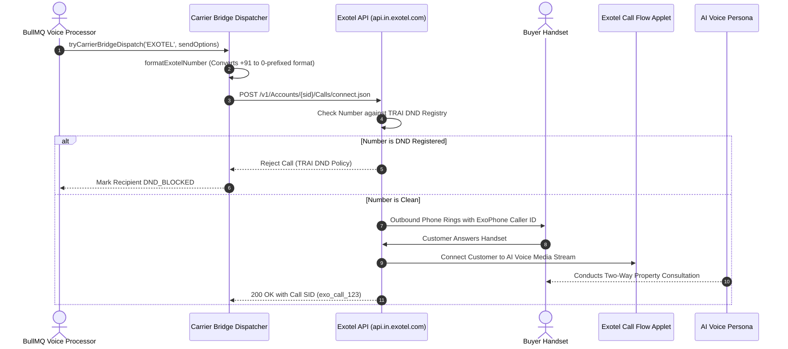

**Exotel** is India's leading cloud telephony platform, widely used by enterprise real estate developers and property brokerages. It provides virtual pilot phone numbers (ExoPhones), automated call recording, and native integration with the Telecom Regulatory Authority of India (TRAI) Do-Not-Disturb (DND) scrubbing infrastructure.

The BrokerOS integration (`integrations/voice/telephony/exotel/`) connects directly to the Exotel v1 REST API to initiate outbound bridged calls and synchronize call records.

---

## Exotel Calling Pipeline



---

## Required Credentials

To connect Exotel, collect the following credentials from your Exotel administrator dashboard:

| Credential Field | Parameter in BrokerOS | Description & Example |
| :--- | :--- | :--- |
| **Account SID** | `Account SID` | Your Exotel Account SID (found under API Settings). |
| **API Key** | `API Key` | Secret API Key string used for Basic HTTP authentication. |
| **API Token** | `API Token` | Secret API Token string paired with your API key. |
| **Subdomain** | `Subdomain` | Your Exotel API cluster domain (e.g., `api.in.exotel.com` or `api.exotel.com`). Defaults to `api.in.exotel.com`. |
| **ExoPhone Number** | `From Numbers` | Your purchased Exotel virtual long number (e.g., `08047123456`). |

---

## Indian Phone Number Normalization (`formatExotelNumber`)

Exotel's telecom switchboard requires destination telephone numbers to be formatted in domestic Indian inter-state dialing format (starting with `0` followed by the 10-digit mobile number), rather than the international `+91` format:

```typescript
// Automatic transformation performed by ExotelTelephonyClient:
"+91 98765 43210"  -->  "09876543210"
"9876543210"       -->  "09876543210"
```

The BrokerOS `ExotelTelephonyClient` automatically reformats international E.164 phone numbers to this required format prior to submitting the `connect.json` request.

---

## Configuration Steps

<Steps>
  <Step title="Retrieve API Credentials from Exotel">
    Log in to `my.exotel.com`. Navigate to **Settings -> API Credentials**. Copy your **Account SID**, **API Key**, and **API Token**. Note your API subdomain (e.g., `api.in.exotel.com`).
  </Step>

  <Step title="Identify Your Outbound ExoPhone Number">
    Under **Numbers**, find the virtual long number assigned to your outbound calling flow.
  </Step>

  <Step title="Add Carrier in BrokerOS Settings">
    In the BrokerOS dashboard:
    1. Navigate to **Dashboard -> Marketing -> Voice -> Settings**.
    2. Select the **Gateways & Voice Platforms** tab (`/dashboard/marketing/voice/settings?tab=providers`).
    3. Under the **Telephony Gateways** sub-tab, click **Add Carrier** and choose **EXOTEL**.
    4. Enter an **Engine Label / Name** (e.g. `Exotel Mumbai Primary`).
    5. Fill in **Account SID**, **API Key**, and **API Token**.
    6. Set **Subdomain** to your cluster hostname (e.g. `api.in.exotel.com`).
    7. Enter your ExoPhone virtual number in **From Numbers**.
    8. Click **Save & Verify Carrier**. Credentials are encrypted with AES-256-GCM and stored in `VoiceTelephonyIntegration`.
  </Step>

  <Step title="Test Connection & Verify Latency">
    Click **Verify Carrier**. BrokerOS queries `https://${subdomain}/v1/Accounts/${accountSid}.json` to confirm authentication and measure network round-trip time.
  </Step>

  <Step title="Perform a Pre-Flight Test Call">
    Use the **Dual-Mode Test Call Modal** from the Agent Composer to place a live test call to your personal handset.
  </Step>
</Steps>

---

## TRAI DND Compliance Enforcement

The Telecom Regulatory Authority of India enforces strict penalties on commercial marketing calls placed to numbers registered in the National Do-Not-Call (NDNC) database:

- Exotel automatically checks the destination phone number against the TRAI registry in real time before ringing the subscriber handset.
- If the prospect is registered on the DND registry, the call is blocked at the telecom switch.
- BrokerOS detects this response and flags the recipient as `DND_BLOCKED` in the campaign call logs, preventing repeated call attempts.
