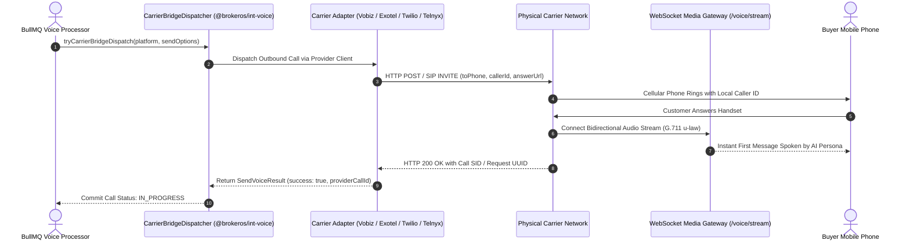

For BrokerOS to dial a physical telephone number for an AI voice campaign or an automated mobile dialer queue, it must establish a connection with the Public Switched Telephone Network (PSTN). Telecom carriers provide the SIP trunking lines, virtual long numbers, and voice channels required to ring customer handsets.

BrokerOS integrates four enterprise phone carriers through a unified interface, allowing brokerages to maintain their own phone number reputation, local caller ID presentation, and custom carrier contracts.

---

## Carrier Bridge Architecture

Rather than hardcoding telecom logic into individual campaign engines, BrokerOS delegates all outbound calls to the **Carrier Bridge Dispatcher** (`tryCarrierBridgeDispatch` in `@brokeros/int-voice`):



---

## The `IVoiceTelephonyProvider` Contract

Every carrier adapter inside `integrations/voice/telephony/` implements the standard TypeScript interface defined in `@brokeros/types`:

```typescript
export interface IVoiceTelephonyProvider {
  readonly providerType: VoiceTelephonyType;
  
  // Validates API credentials and checks account status
  validateCredentials(credentials?: VoiceTelephonyCredentials): Promise<boolean>;
  
  // Initiates an immediate short verification test call
  testCarrierCall(
    toPhone: string,
    fromNumber: string,
    credentials?: VoiceTelephonyCredentials,
  ): Promise<{ success: boolean; callId?: string; error?: string }>;
}
```

---

## Supported Telephony Carriers

<CardGroup cols={2}>
  <Card title="Vobiz" icon="tower-cell" href="/integrations/telephony/vobiz">
    **Primary Region**: India (Local Geographic CLI).
    
    Direct REST API and SIP trunking with Indian mobile and landline caller ID display. Delivers low domestic per-minute termination rates and dynamic XML answer callbacks.
  </Card>

  <Card title="Exotel" icon="headset" href="/integrations/telephony/exotel">
    **Primary Region**: India (Enterprise Cloud Telephony).
    
    India's leading cloud telephony platform. Provides virtual pilot numbers (ExoPhones), automated call recording, and native TRAI DND (Do Not Disturb) compliance scrubbing.
  </Card>

  <Card title="Twilio" icon="network-wired" href="/integrations/telephony/twilio">
    **Primary Region**: Global (180+ Countries).
    
    Industry-standard cloud communications platform. Supports programmable voice, international caller ID pools, TwiML call orchestration, and real-time Twilio Media Streams.
  </Card>

  <Card title="Telnyx" icon="satellite-dish" href="/integrations/telephony/telnyx">
    **Primary Region**: Global (Private IP Network).
    
    Carrier-grade elastic SIP trunking built on a private global IP backbone. Delivers ultra-low conversational latency, automated Outbound Voice Profiles, and TeXML media streaming.
  </Card>
</CardGroup>

---

## Carrier Feature Matrix

| Feature / Capability | Vobiz | Exotel | Twilio | Telnyx |
| :--- | :--- | :--- | :--- | :--- |
| **Primary Protocol** | REST API & XML Callback | REST API & Basic Auth | REST API & TwiML | REST API v2 & TeXML |
| **Indian CLI Presentation** | Supported (Local City Numbers) | Supported (Virtual ExoPhones) | Supported (Regulatory Docs Required) | International E.164 |
| **Automated DND Scrubbing** | Handled via API | Built-in TRAI Registry Scrub | Custom Suppression Lists | Custom Suppression Lists |
| **Media Stream WebSocket** | Dynamic Answer Callback | Call Routing Applet | Native Twilio Media Streams | Native TeXML Media Streams |
| **Audio Transcoding** | G.711 u-law (8kHz) | G.711 A-law / u-law | G.711 u-law / Linear PCM | G.711 u-law / Opus |
| **Multiple From Numbers** | Supported (Trunk Pool) | Supported (ExoPhone Group) | Supported (Number Inventory) | Supported (Number Inventory) |

---

## Live Carrier Verification & Latency Testing

Through the **Telephony Carriers Settings Tab** (`TelephonyCarriersTab.tsx`), administrators can test and monitor connected trunks:

1. Navigate to **Dashboard -> Marketing -> Voice -> Settings -> Telephony Carriers**.
2. Click **Verify Carrier** on any configured trunk.
3. BrokerOS triggers `POST /api/marketing/voice/integrations/telephony/:id/verify`.
4. The system invokes `validateCredentials()`, executes an authenticated ping against the provider's API, and measures round-trip network latency in milliseconds.
5. If valid, an emerald status badge displays the latency readout (for example, *Valid: 76ms*). If credentials are revoked or expired, an alert banner details the specific error response.

---

## Carrier Webhook Ingestion Routes

When an outbound call is answered or concluded, carriers notify BrokerOS via dedicated webhook routes handled by `VoiceWebhooksController`:

- **Vobiz Answer XML**: `/api/marketing/voice/webhooks/vobiz-answer`
- **Exotel Status Callback**: `/api/marketing/voice/webhooks/exotel`
- **Twilio TwiML Callback**: `/api/marketing/voice/webhooks/twilio-answer`
- **Telnyx TeXML Callback**: `/api/marketing/voice/webhooks/telnyx-answer`

---

## Related Guides

- [Connect Vobiz](file:///c:/Users/Sumama/Desktop/enterprise-crm-realtors/docs/integrations/telephony/vobiz.mdx)
- [Connect Exotel](file:///c:/Users/Sumama/Desktop/enterprise-crm-realtors/docs/integrations/telephony/exotel.mdx)
- [Connect Twilio](file:///c:/Users/Sumama/Desktop/enterprise-crm-realtors/docs/integrations/telephony/twilio.mdx)
- [Connect Telnyx](file:///c:/Users/Sumama/Desktop/enterprise-crm-realtors/docs/integrations/telephony/telnyx.mdx)
- [Carrier Telephony Bridge in Voice Suite](file:///c:/Users/Sumama/Desktop/enterprise-crm-realtors/docs/marketing/voice/carrier-telephony.mdx)
