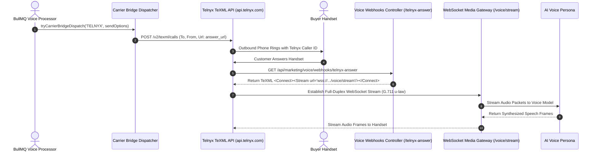

**Telnyx** is a carrier-grade communications platform built on an elastic private global IP backbone. It provides deep PSTN interconnects, wholesale per-minute pricing, and direct programmatic control over call routing. Telnyx is ideal for brokerages running high-concurrency voice broadcasts where minimizing audio packet round-trip latency is vital for conversational realism.

The BrokerOS integration (`integrations/voice/telephony/telnyx/`) uses the Telnyx v2 API, automated Outbound Voice Profiles, and bidirectional TeXML Media Streams.

---

## Telnyx Calling Pipeline



---

## Required Credentials

To connect Telnyx to BrokerOS, retrieve the following credentials from the Telnyx Mission Control Portal:

| Credential Field | Parameter in BrokerOS | Requirements & Format |
| :--- | :--- | :--- |
| **API Key** | `API Key` | Version 2 API Key starting with `KEY...` (e.g., `KEY018...`). |
| **Connection ID / App ID** | `Account SID` | (Optional) Call Control Application ID or SIP Connection ID. |
| **From Numbers** | `From Numbers` | Verified Telnyx phone number in international E.164 format (e.g., `+18005550199`). |

---

## Automated Outbound Voice Profile Provisioning

Before an outbound telephone call can be placed through Telnyx, an active **Outbound Voice Profile** must be linked to your account.

BrokerOS automates this setup in `TelnyxTelephonyClient`:
1. Queries `https://api.telnyx.com/v2/outbound_voice_profiles` to verify existing profiles.
2. If no profile exists, automatically provisions a **BrokerOS Outbound Voice Profile** with `traffic_type: 'conversational'` and `usage_payment_method: 'rate-deck'`.
3. Attaches the outbound voice profile to your Call Control Application via `PATCH /v2/call_control_applications/{appId}`.

---

## Configuration Steps

<Steps>
  <Step title="Generate an API Key in Telnyx Portal">
    Log in to [Telnyx Mission Control](https://portal.telnyx.com). Navigate to **API Keys** and generate a new V2 API Key.
  </Step>

  <Step title="Ensure API_PUBLIC_URL is Configured">
    Telnyx requires a public URL for the TeXML `answer_url` parameter. Ensure `API_PUBLIC_URL` is configured in your root `.env` (e.g., `API_PUBLIC_URL="https://api.yourdomain.com"`).
  </Step>

  <Step title="Add Carrier in BrokerOS Settings">
    In the BrokerOS dashboard:
    1. Navigate to **Dashboard -> Marketing -> Voice -> Settings**.
    2. Select the **Gateways & Voice Platforms** tab (`/dashboard/marketing/voice/settings?tab=providers`).
    3. Under the **Telephony Gateways** sub-tab, click **Add Carrier** and select **TELNYX**.
    4. Enter an **Engine Label / Name** (e.g. `Telnyx Ultra-Low Latency Trunk`).
    5. Paste your V2 API Key into the **API Key** field.
    6. Enter your purchased Telnyx number in **From Numbers**.
    7. Click **Save & Verify Carrier**. Credentials are encrypted with AES-256-GCM and stored in `VoiceTelephonyIntegration`.
  </Step>

  <Step title="Verify Carrier Credentials">
    Click **Verify Carrier**. BrokerOS tests credentials against `https://api.telnyx.com/v2/phone_numbers` and measures network latency.
  </Step>

  <Step title="Place a Test Call">
    Use the **Dual-Mode Test Call Modal** from the Agent Composer to verify that the TeXML media stream connects cleanly to your phone.
  </Step>
</Steps>

---

## TeXML Media Stream Handshake

When an outbound call is answered, Telnyx executes the TeXML response provided by `/api/marketing/voice/webhooks/telnyx-answer`:

```xml
<?xml version="1.0" encoding="UTF-8"?>
<Response>
  <Connect>
    <Stream url="wss://api.yourdomain.com/voice/stream">
      <Parameter name="campaignId" value="camp_priority_penthouse"/>
      <Parameter name="agent" value="RETELL"/>
    </Stream>
  </Connect>
</Response>
```

This establishes an ultra-low latency WebSocket stream, piping 160-byte audio packets directly to `VoiceMediaStreamGateway.ts`.
