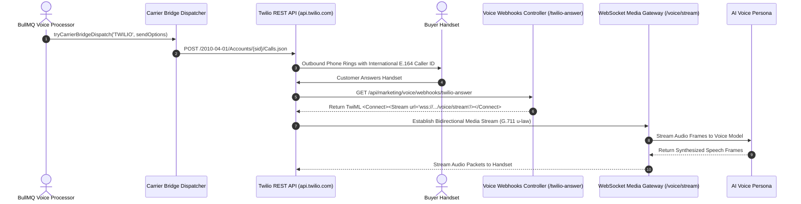

**Twilio** is the industry standard for programmable cloud communications, providing outbound telephone calling in more than 180 countries. For international real estate brokerages targeting Non-Resident Indian (NRI) buyers, high-net-worth investors in Dubai, Singapore, the United States, and the United Kingdom, Twilio provides reliable caller ID presentation and global PSTN termination.

The BrokerOS integration (`integrations/voice/telephony/twilio/`) utilizes Twilio Programmable Voice REST APIs, dynamic TwiML orchestration, and bidirectional WebSocket Media Streams.

---

## Twilio Calling Pipeline



---

## Required Credentials

To connect Twilio, retrieve the following credentials from your Twilio Console:

| Credential Field | Parameter in BrokerOS | Requirements & Format |
| :--- | :--- | :--- |
| **Account SID** | `Account SID` | String starting with `AC` (exactly 34 characters). |
| **Auth Token** | `Auth Token` | Primary API authentication secret (32+ characters). |
| **From Numbers** | `From Numbers` | Verified Twilio phone number in international E.164 format (e.g., `+14155550199` or `+911140001234`). |

---

## Configuration Steps

<Steps>
  <Step title="Retrieve Credentials from Twilio Console">
    Open the [Twilio Console](https://console.twilio.com). Under **Account Info**, copy your **Account SID** and **Auth Token**.
  </Step>

  <Step title="Acquire or Provision Outbound Phone Numbers">
    Navigate to **Phone Numbers -> Manage -> Active Numbers**. Ensure you have at least one voice-enabled telephone number matching your target campaign country.
  </Step>

  <Step title="Add Carrier in BrokerOS Settings">
    In the BrokerOS dashboard:
    1. Navigate to **Dashboard -> Marketing -> Voice -> Settings**.
    2. Select the **Gateways & Voice Platforms** tab (`/dashboard/marketing/voice/settings?tab=providers`).
    3. Under the **Telephony Gateways** sub-tab, click **Add Carrier** and select **TWILIO**.
    4. Enter an **Engine Label / Name** (e.g. `Twilio Global Production Trunk`).
    5. Fill in **Account SID** and **Auth Token**.
    6. Enter your purchased phone number in **From Numbers**.
    7. Click **Save & Verify Carrier**. Credentials are encrypted with AES-256-GCM and stored in `VoiceTelephonyIntegration`.
  </Step>

  <Step title="Verify Carrier Credentials">
    Click **Verify Carrier**. BrokerOS queries `https://api.twilio.com/2010-04-01/Accounts/${accountSid}.json`, confirms that account status is `active`, and measures network latency.
  </Step>

  <Step title="Test Outbound Cellular Call">
    Launch a test call using the **Dual-Mode Test Call Modal** to confirm your phone rings and connects properly.
  </Step>
</Steps>

---

## Twilio Media Streams (WebSocket Integration)

When running low-latency conversational agents (such as OpenAI Realtime or Pipecat), BrokerOS utilizes **Twilio Media Streams**:

1. Twilio executes the TwiML response returned by `/api/marketing/voice/webhooks/twilio-answer`:
   ```xml
   <?xml version="1.0" encoding="UTF-8"?>
   <Response>
     <Connect>
       <Stream url="wss://api.yourdomain.com/voice/stream">
         <Parameter name="campaignId" value="camp_luxury_launch"/>
         <Parameter name="agent" value="VAPI"/>
       </Stream>
     </Connect>
   </Response>
   ```
2. Twilio opens a WebSocket connection to BrokerOS on `/voice/stream`.
3. Audio packets are exchanged using 8-bit G.711 u-law companded frames at 8kHz, transcoded in real time by `VoiceAudioTranscoder.ts`.

---

## TwiML Test Voice Prompts

When running single verification test calls from the carrier management tab, BrokerOS instructs Twilio using native Amazon Polly speech synthesis embedded in TwiML:

```xml
<Response>
  <Say voice="Polly.Aditi">
    Hello! This is a carrier verification test call from BrokerOS. Your Twilio telephony connection is fully active and verified.
  </Say>
  <Pause length="1"/>
  <Hangup/>
</Response>
```
