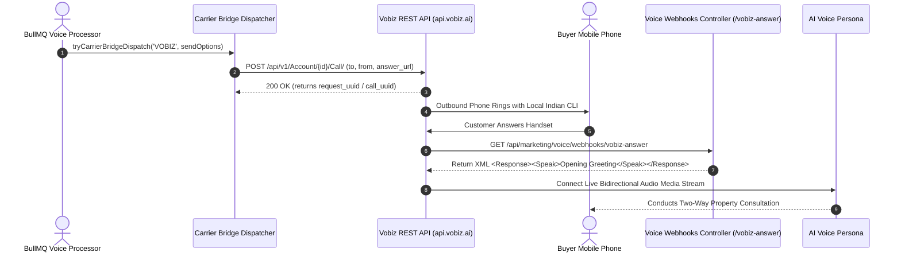

**Vobiz** is an enterprise telecommunications provider specialized in the Indian market. It provides programmatic outbound voice termination with Indian geographic Caller Line Identification (CLI) numbers. When prospective buyers receive an outbound call from an AI agent, the caller ID displays a recognized local city mobile or landline number (such as Delhi NCR, Mumbai, or Bengaluru), dramatically increasing pick-up rates compared to international or toll-free numbers.

The BrokerOS integration (`integrations/voice/telephony/vobiz/`) connects to Vobiz using its REST API and dynamic XML answer callbacks.

---

## Vobiz Calling Pipeline



---

## Required Credentials

To connect Vobiz to BrokerOS, obtain the following credentials from your Vobiz account portal:

| Credential Field | Parameter in BrokerOS | Description & Format |
| :--- | :--- | :--- |
| **X-Auth-ID** | `API Key` / `Auth ID` | Your unique Vobiz account identification string (e.g., `vob_acc_98231...`). |
| **X-Auth-Token** | `API Token` / `Auth Token` | Secret API authentication token used in request headers. |
| **Registered Caller ID** | `From Numbers` | Verified Indian mobile or landline number assigned to your trunk (e.g., `+919876543210`). |

---

## Configuration Steps

<Steps>
  <Step title="Retrieve Credentials from Vobiz Portal">
    Log in to your account at `portal.vobiz.in`. Under **API & Credentials**, copy your **X-Auth-ID** and **X-Auth-Token**.
  </Step>

  <Step title="Ensure API_PUBLIC_URL is Configured">
    Vobiz requires an accessible public HTTP or HTTPS webhook URL for its `answer_url` callback. In your root `.env` or production deployment environment, ensure `API_PUBLIC_URL` points to your public domain or tunnel:
    ```bash
    API_PUBLIC_URL="https://api.yourdomain.com"
    ```
    If testing locally, start an ngrok tunnel (e.g., `API_PUBLIC_URL="https://brokeros.ngrok-free.app"`). The dispatcher explicitly validates that `API_PUBLIC_URL` is a valid public URL and not `localhost`.
  </Step>

  <Step title="Add Carrier in BrokerOS Settings">
    In the BrokerOS dashboard:
    1. Navigate to **Dashboard -> Marketing -> Voice -> Settings**.
    2. Select the **Gateways & Voice Platforms** tab (`/dashboard/marketing/voice/settings?tab=providers`).
    3. Under the **Telephony Gateways** sub-tab, click **Add Carrier** and select **VOBIZ**.
    4. Enter an **Engine Label / Name** (e.g. `Vobiz India Primary Trunk`).
    5. Paste your **X-Auth-ID** into the **API Key** field.
    6. Paste your **X-Auth-Token** into the **API Token** field.
    7. Enter your verified Indian caller ID in the **From Numbers** field.
    8. Click **Save & Verify Carrier**. Credentials are encrypted with AES-256-GCM and stored in `VoiceTelephonyIntegration`.
  </Step>

  <Step title="Verify Carrier Connection">
    Click **Verify Carrier**. BrokerOS tests credentials against `https://api.vobiz.ai/api/v1/account` and measures the connection latency. Upon success, a green badge displays the response time.
  </Step>

  <Step title="Run a Dual-Mode Test Call">
    Open the **Campaign Wizard** or **Agent Composer**, click **Test Call**, select **Carrier Bridge PSTN**, and verify that your personal handset rings with your configured Indian CLI.
  </Step>
</Steps>

---

## Dynamic XML Answer Callback

When a customer answers an outbound call originated through Vobiz, Vobiz makes an immediate HTTP GET or POST request to the BrokerOS answer webhook:

```
GET /api/marketing/voice/webhooks/vobiz-answer?campaignId=camp_123&agent=VAPI&voice=sarvam_bulbul
```

BrokerOS responds with compliant Vobiz XML:

```xml
<?xml version="1.0" encoding="UTF-8"?>
<Response>
  <Speak>Hello! Thank you for connecting with us from Skyline Realty. Your voice session is active.</Speak>
</Response>
```

---

## Troubleshooting & Best Practices

- **Error: Vobiz API requires a public HTTP/HTTPS webhook URL**: Occurs when `API_PUBLIC_URL` is either empty or points to `localhost`/`127.0.0.1`. Update your environment configuration with a publicly resolvable hostname.
- **Error: Missing Vobiz X-Auth-ID or X-Auth-Token**: Verify that both fields are populated in **Telephony Carriers Settings**.
- **CLI Presentation Issues**: Telecom operators in India require caller IDs to be pre-registered with your telecom account. Ensure the phone number in `From Numbers` matches an active CLI in your Vobiz dashboard.
