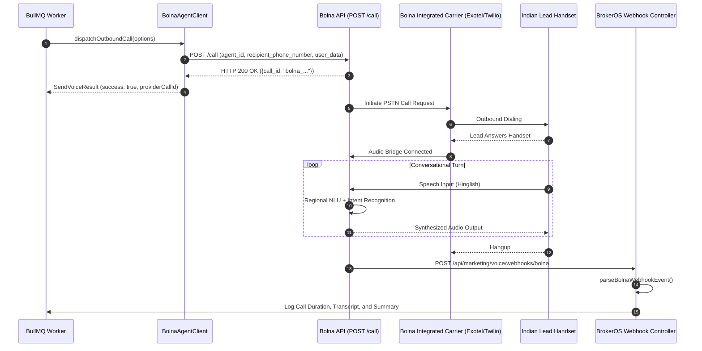

## Overview

Bolna is an open-source voice AI framework and cloud platform designed for Indian linguistic environments, code-switching (*Hinglish*), and regional real estate terminology (*Crores, Lakhs, Vastu, BDA Katha, Possession*). In BrokerOS, the Bolna integration is implemented in [`integrations/voice/agents/bolna/src/index.ts`](file:///c:/Users/Sumama/Desktop/enterprise-crm-realtors/integrations/voice/agents/bolna/src/index.ts) under the Turborepo workspace package `@brokeros/int-agent-bolna`.

BrokerOS administrators configure Bolna directly within the Web UI at **Dashboard -> Marketing -> Voice -> Settings**. All credentials are encrypted with AES-256-GCM and stored in PostgreSQL (`VoiceAgentIntegration`). Bolna functions both as an API-managed service and as a self-hosted private container within your own cloud infrastructure (AWS VPC or GCP) for strict data sovereignty.

---

## Architecture and Dispatch Sequence

The Bolna integration implements the `IVoiceAgentProvider` contract from [`@brokeros/types`](file:///c:/Users/Sumama/Desktop/enterprise-crm-realtors/packages/types).



---

## Step 1: Obtain Credentials from Bolna

1. Log into your account at [bolna.dev](https://bolna.dev).
2. Navigate to **Settings -> API Tokens**.
3. Create a new token with read/write access and copy the generated key.
4. In the **Agents** tab, create or inspect your target agent.

---

## Step 2: Connect in the BrokerOS Web Dashboard

In your BrokerOS dashboard:

1. Navigate to **Dashboard -> Marketing -> Voice -> Settings**.
2. Select the **Gateways & Voice Platforms** tab (`/dashboard/marketing/voice/settings?tab=providers`).
3. Click the **AI Voice Platforms** sub-tab.
4. Click **Add Platform** and select **Bolna AI**.
5. Fill in the modal connection fields:

| UI Modal Field | Required | Description & Example |
| :--- | :--- | :--- |
| **Engine Label / Name** | Yes | Friendly label in CRM (e.g. `Bolna Hinglish Engine`). |
| **Bolna API Key** | Yes | API Token generated in Bolna settings. |
| **Server URL** | Optional | Custom endpoint if running self-hosted Bolna container. |

6. Click **Save & Verify Engine**. BrokerOS verifies the key with `GET https://api.bolna.ai/user/me`, encrypts the credentials via AES-256-GCM, and saves them in `VoiceAgentIntegration`.

---

## Integration Implementation Details

The Bolna client and dispatcher are located in [`integrations/voice/agents/bolna/src/index.ts`](file:///c:/Users/Sumama/Desktop/enterprise-crm-realtors/integrations/voice/agents/bolna/src/index.ts) and [`integrations/voice/agents/bolna/src/bolna-dispatcher.ts`](file:///c:/Users/Sumama/Desktop/enterprise-crm-realtors/integrations/voice/agents/bolna/src/bolna-dispatcher.ts).

### Live Verification Engine

When tested in the UI, `BolnaAgentClient.validateCredentials()` executes an authenticated health check:

```typescript
export class BolnaAgentClient implements IVoiceAgentProvider {
  readonly platformType: VoiceAgentPlatform = 'BOLNA';
  private apiKey: string;

  constructor(credentials?: VoiceAgentCredentials) {
    this.apiKey = credentials?.apiKey || process.env.BOLNA_API_KEY || '';
  }

  async validateCredentials(credentials?: VoiceAgentCredentials): Promise<boolean> {
    const key = credentials?.apiKey || this.apiKey;
    if (!key) return false;
    try {
      const res = await fetch('https://api.bolna.ai/user/me', {
        method: 'GET',
        headers: { Authorization: `Bearer ${key}` },
      });
      return res.status === 200;
    } catch {
      return key.length >= 16;
    }
  }
}
```

### Outbound Call Dispatch and Overrides

The dispatcher resolves configured agents dynamically and injects lead attributes and campaign scripts into `user_data`:

```typescript
let agentId = isAgentUUID(options.llmModel) ? options.llmModel : null;

if (!agentId) {
  const aRes = await fetch('https://api.bolna.ai/agent/all', {
    headers: { Authorization: `Bearer ${apiKey}` },
  });
  if (aRes.ok) {
    const data = await aRes.json();
    const list = Array.isArray(data) ? data : data?.items || [];
    if (list.length > 0) agentId = list[0].id || list[0].agent_id;
  }
}

const callPayload: any = {
  agent_id: agentId,
  recipient_phone_number: options.toPhone,
  user_data: {
    ...options.variables,
    prompt: options.scriptPrompt,
  },
};

if (options.fromNumber) {
  callPayload.from_phone_number = options.fromNumber;
}

const res = await fetch('https://api.bolna.ai/call', {
  method: 'POST',
  headers: {
    Authorization: `Bearer ${apiKey}`,
    'Content-Type': 'application/json',
  },
  body: JSON.stringify(callPayload),
});
```

### Trial Account Guard

If testing on a Bolna trial account, the dispatcher intercepts the trial restriction error and surfaces guidance in the BrokerOS interface:

```typescript
if (typeof errMsg === 'string' && errMsg.includes('Trial accounts can only make calls to verified')) {
  return {
    success: false,
    error: 'Bolna trial account restriction: Calls can only be placed to verified numbers in your Bolna dashboard.',
  };
}
```
