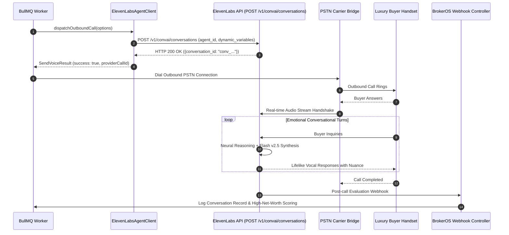

## Overview

ElevenLabs is an industry leader in synthetic speech quality and emotional realism. In BrokerOS, the ElevenLabs integration is implemented in [`integrations/voice/agents/elevenlabs/src/index.ts`](file:///c:/Users/Sumama/Desktop/enterprise-crm-realtors/integrations/voice/agents/elevenlabs/src/index.ts) under the Turborepo workspace package `@brokeros/int-agent-elevenlabs`.

BrokerOS administrators configure ElevenLabs accounts directly inside the Web UI at **Dashboard -> Marketing -> Voice -> Settings**. All credentials are encrypted using AES-256-GCM and stored in PostgreSQL (`VoiceAgentIntegration`).

---

## Architecture and Dispatch Sequence

The ElevenLabs integration implements the `IVoiceAgentProvider` contract from [`@brokeros/types`](file:///c:/Users/Sumama/Desktop/enterprise-crm-realtors/packages/types). Outbound sessions initialize through the ElevenLabs Conversational AI API and bridge to PSTN carriers.



---

## Step 1: Obtain Credentials from ElevenLabs

1. Log into your account at [elevenlabs.io](https://elevenlabs.io).
2. Click your profile avatar in the bottom-left corner and navigate to **API Keys**.
3. Create and copy your API key.
4. Navigate to **Conversational AI** in the left menu to inspect or create an agent persona.

---

## Step 2: Connect in the BrokerOS Web Dashboard

In your BrokerOS dashboard:

1. Navigate to **Dashboard -> Marketing -> Voice -> Settings**.
2. Select the **Gateways & Voice Platforms** tab (`/dashboard/marketing/voice/settings?tab=providers`).
3. Click the **AI Voice Platforms** sub-tab.
4. Click **Add Platform** and select **ElevenLabs Conversational**.
5. Fill in the modal connection fields:

| UI Modal Field | Required | Description & Example |
| :--- | :--- | :--- |
| **Engine Label / Name** | Yes | Friendly label in CRM (e.g. `ElevenLabs Luxury Sales Engine`). |
| **ElevenLabs API Key** | Yes | API Key copied from ElevenLabs settings. |

6. Click **Save & Verify Engine**. BrokerOS tests the key against `GET https://api.elevenlabs.io/v1/models`, encrypts it using AES-256-GCM, and saves it in `VoiceAgentIntegration`.

---

## Luxury Real Estate Voice Cloning

For flagship developments (villas and penthouses priced above 5 Crores INR), firms can clone the voice of the Managing Director or Chief Architect:

- **Executive VIP Touch**: Delivers a tailored personal greeting: *"Good afternoon Mr. Singhania, this is Vikram from Prestige Sanctuary. I wanted to personally update you on our limited release of golf-facing villas..."*
- **Acoustic Fidelity**: Neural voice stability and similarity settings prevent robotic artifacts.
- **Dynamic Variable Injection**: Automatically inserts lead name, enquired property, and budget targets directly into the conversational flow.

---

## Integration Implementation Details

The ElevenLabs integration logic is defined in [`integrations/voice/agents/elevenlabs/src/index.ts`](file:///c:/Users/Sumama/Desktop/enterprise-crm-realtors/integrations/voice/agents/elevenlabs/src/index.ts) and [`integrations/voice/agents/elevenlabs/src/elevenlabs-dispatcher.ts`](file:///c:/Users/Sumama/Desktop/enterprise-crm-realtors/integrations/voice/agents/elevenlabs/src/elevenlabs-dispatcher.ts).

### Live Verification Engine

When tested in the UI, `ElevenLabsAgentClient.validateCredentials()` executes an authenticated health check:

```typescript
export class ElevenLabsAgentClient implements IVoiceAgentProvider {
  readonly platformType: VoiceAgentPlatform = 'ELEVENLABS';
  private apiKey: string;

  constructor(credentials?: VoiceAgentCredentials) {
    this.apiKey = credentials?.apiKey || process.env.ELEVENLABS_API_KEY || '';
  }

  async validateCredentials(credentials?: VoiceAgentCredentials): Promise<boolean> {
    const key = credentials?.apiKey || this.apiKey;
    if (!key) return false;
    try {
      const res = await fetch('https://api.elevenlabs.io/v1/models', {
        method: 'GET',
        headers: { 'xi-api-key': key },
      });
      return res.status === 200;
    } catch {
      return key.length >= 24;
    }
  }
}
```

### Conversational AI Dispatch

Outbound conversations are initiated via `POST /v1/convai/conversations`, injecting lead attributes and unit details into dynamic variables:

```typescript
export async function dispatchElevenLabsCall(
  apiKey: string,
  options: SendVoiceOptions,
): Promise<SendVoiceResult> {
  const targetAgentId = options.assistantId || 
    (options.voiceId && options.voiceId.length >= 10 ? options.voiceId : null);

  if (!targetAgentId) {
    return {
      success: false,
      error: 'No ElevenLabs Agent ID specified for outbound call.',
    };
  }

  const res = await fetch('https://api.elevenlabs.io/v1/convai/conversations', {
    method: 'POST',
    headers: {
      'xi-api-key': apiKey,
      'Content-Type': 'application/json',
    },
    body: JSON.stringify({
      agent_id: targetAgentId,
      dynamic_variables: options.variables || {},
    }),
  });

  const data = (await res.json().catch(() => ({}))) as any;

  if (res.status >= 200 && res.status < 300) {
    return {
      success: true,
      providerCallId: data.conversation_id || `11labs_${Date.now()}`,
    };
  }

  return {
    success: false,
    error: data.detail?.message || `ElevenLabs dispatch failed with HTTP ${res.status}`,
  };
}
```
