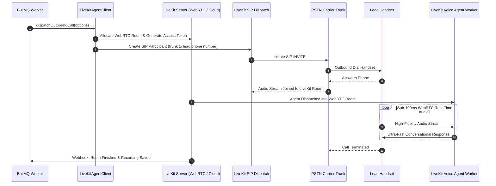

## Overview

LiveKit is an open-source real-time communication platform built on WebRTC and distributed media servers. In BrokerOS, the LiveKit integration is implemented in [`integrations/voice/agents/livekit/src/index.ts`](file:///c:/Users/Sumama/Desktop/enterprise-crm-realtors/integrations/voice/agents/livekit/src/index.ts) under the Turborepo workspace package `@brokeros/int-agent-livekit`.

BrokerOS administrators configure LiveKit directly inside the Web UI at **Dashboard -> Marketing -> Voice -> Settings**. All API credentials and server endpoints are encrypted using AES-256-GCM and stored in PostgreSQL (`VoiceAgentIntegration`).

---

## Architecture and Dispatch Sequence

The LiveKit integration implements the `IVoiceAgentProvider` contract from [`@brokeros/types`](file:///c:/Users/Sumama/Desktop/enterprise-crm-realtors/packages/types).



---

## Step 1: Obtain Credentials from LiveKit

1. Log into your account at [cloud.livekit.io](https://cloud.livekit.io) (or your self-hosted LiveKit instance).
2. Open your project dashboard.
3. Under **Project Settings -> Keys**, generate and copy your **API Key** and **API Secret**.
4. Copy your project **WebSocket Server URL** (e.g. `wss://yourproject.livekit.cloud`).

---

## Step 2: Connect in the BrokerOS Web Dashboard

In your BrokerOS dashboard:

1. Navigate to **Dashboard -> Marketing -> Voice -> Settings**.
2. Select the **Gateways & Voice Platforms** tab (`/dashboard/marketing/voice/settings?tab=providers`).
3. Click the **AI Voice Platforms** sub-tab.
4. Click **Add Platform** and select **LiveKit Agents**.
5. Fill in the modal connection fields:

| UI Modal Field | Required | Description & Example |
| :--- | :--- | :--- |
| **Engine Label / Name** | Yes | Friendly label in CRM (e.g. `LiveKit Cloud WebRTC Engine`). |
| **LiveKit API Key** | Yes | Project API Key starting with `API...`. |
| **Server URL** | Yes | WebSocket URL (`wss://yourproject.livekit.cloud`). |

6. Click **Save & Verify Engine**. BrokerOS verifies connectivity, encrypts credentials via AES-256-GCM, and saves them in `VoiceAgentIntegration`.

---

## Integration Implementation Details

The LiveKit integration logic is located in [`integrations/voice/agents/livekit/src/index.ts`](file:///c:/Users/Sumama/Desktop/enterprise-crm-realtors/integrations/voice/agents/livekit/src/index.ts) and [`integrations/voice/agents/livekit/src/livekit-dispatcher.ts`](file:///c:/Users/Sumama/Desktop/enterprise-crm-realtors/integrations/voice/agents/livekit/src/livekit-dispatcher.ts).

### Live Verification Engine

The client validates connectivity and configuration options:

```typescript
export class LiveKitAgentClient implements IVoiceAgentProvider {
  readonly platformType: VoiceAgentPlatform = 'LIVEKIT';
  private apiKey: string;
  private serverUrl: string;

  constructor(credentials?: VoiceAgentCredentials) {
    this.apiKey = credentials?.apiKey || process.env.LIVEKIT_API_KEY || '';
    this.serverUrl = credentials?.serverUrl || process.env.LIVEKIT_URL || 'https://livekit.cloud';
  }

  async validateCredentials(credentials?: VoiceAgentCredentials): Promise<boolean> {
    const key = credentials?.apiKey || this.apiKey;
    return !!key && key.length >= 8;
  }
}
```

### SIP Participant Call Dispatch

When an outbound call is dispatched, LiveKit creates a room, assigns an agent participant, and instructs the SIP participant dispatcher to dial the target PSTN line:

```typescript
export async function dispatchLiveKitCall(
  apiKey: string,
  serverUrl: string,
  options: SendVoiceOptions,
  credentials?: VoiceAgentCredentials,
): Promise<SendVoiceResult> {
  // Dispatches SIP Participant to connect carrier trunk
  // Generates room token and attaches dynamic real estate context
}
```
