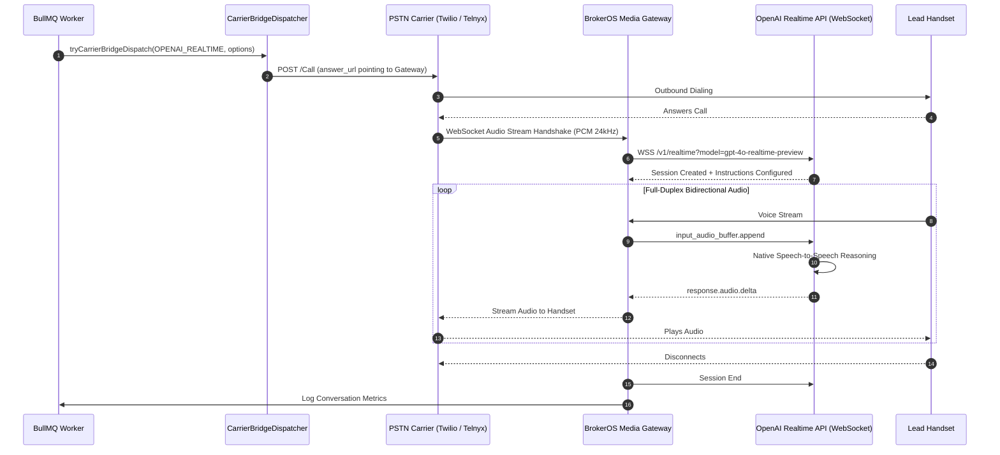

## Overview

Traditional voice AI systems stitch together three sequential technologies: Speech-to-Text (STT), a Large Language Model (LLM), and Text-to-Speech (TTS). Each handoff adds 150ms to 400ms of lag, resulting in noticeable latency and stripped vocal inflections.

The **OpenAI Realtime API** (`gpt-4o-realtime-preview`) processes speech natively from audio input to audio output over a bidirectional WebSocket. In BrokerOS, the OpenAI Realtime integration is implemented in [`integrations/voice/agents/openai-realtime/src/index.ts`](file:///c:/Users/Sumama/Desktop/enterprise-crm-realtors/integrations/voice/agents/openai-realtime/src/index.ts) under the Turborepo workspace package `@brokeros/int-agent-openai-realtime`.

BrokerOS administrators configure the OpenAI Realtime engine directly within the Web UI at **Dashboard -> Marketing -> Voice -> Settings**. All API keys are encrypted with AES-256-GCM and stored in PostgreSQL (`VoiceAgentIntegration`).

---

## Architecture and Dispatch Sequence

The OpenAI Realtime integration implements the `IVoiceAgentProvider` contract from [`@brokeros/types`](file:///c:/Users/Sumama/Desktop/enterprise-crm-realtors/packages/types). Audio streams over a full-duplex WebSocket connection between OpenAI and the BrokerOS Media Gateway.



---

## Step 1: Obtain Credentials from OpenAI Platform

1. Log into your account at [platform.openai.com](https://platform.openai.com).
2. Ensure your organization project has access to `gpt-4o-realtime-preview`.
3. Navigate to **API Keys** in the left sidebar menu.
4. Click **Create new secret key** and copy your private key (`sk-proj-...`).

---

## Step 2: Connect in the BrokerOS Web Dashboard

In your BrokerOS dashboard:

1. Navigate to **Dashboard -> Marketing -> Voice -> Settings**.
2. Select the **Gateways & Voice Platforms** tab (`/dashboard/marketing/voice/settings?tab=providers`).
3. Click the **AI Voice Platforms** sub-tab.
4. Click **Add Platform** and select **OpenAI Realtime API**.
5. Fill in the modal connection fields:

| UI Modal Field | Required | Description & Example |
| :--- | :--- | :--- |
| **Engine Label / Name** | Yes | Friendly label in CRM (e.g. `OpenAI Realtime GPT-4o Engine`). |
| **OpenAI API Key** | Yes | Secret API Key starting with `sk-...`. |

6. Click **Save & Verify Engine**. BrokerOS verifies the key via `GET https://api.openai.com/v1/models`, encrypts it using AES-256-GCM, and saves it in `VoiceAgentIntegration`.

---

## Native Voice Persona Selection

The integration exposes OpenAI's eight native neural voice personas in the Agent Composer Studio:
- **Alloy**: Balanced, versatile professional tone
- **Ash**: Warm, authoritative cadence
- **Ballad**: Soft, calm, and reassuring
- **Coral**: Energetic, engaging, and friendly
- **Echo**: Confident, articulate male voice
- **Sage**: Experienced, mature executive presence
- **Shimmer**: Expressive, clear, and upbeat
- **Verse**: Direct, dynamic, and crisp

---

## Integration Implementation Details

The OpenAI Realtime client is defined in [`integrations/voice/agents/openai-realtime/src/index.ts`](file:///c:/Users/Sumama/Desktop/enterprise-crm-realtors/integrations/voice/agents/openai-realtime/src/index.ts).

### Live Verification Engine

When tested in the UI, `OpenAIRealtimeAgentClient.validateCredentials()` executes an authenticated health check:

```typescript
export class OpenAIRealtimeAgentClient implements IVoiceAgentProvider {
  readonly platformType: VoiceAgentPlatform = 'OPENAI_REALTIME';
  private apiKey: string;

  constructor(credentials?: VoiceAgentCredentials) {
    this.apiKey = credentials?.apiKey || process.env.OPENAI_API_KEY || '';
  }

  async validateCredentials(credentials?: VoiceAgentCredentials): Promise<boolean> {
    const key = credentials?.apiKey || this.apiKey;
    if (!key) return false;
    try {
      const res = await fetch('https://api.openai.com/v1/models', {
        headers: { Authorization: `Bearer ${key}` },
      });
      return res.status === 200;
    } catch {
      return key.startsWith('sk-') && key.length >= 20;
    }
  }
}
```
