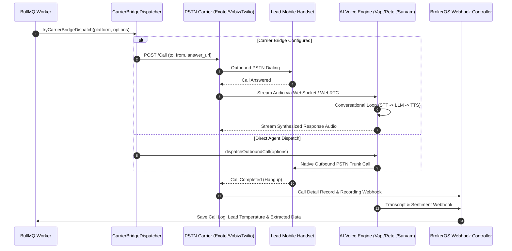

## Universal Voice Architecture

BrokerOS decouples telecommunications transport from conversational artificial intelligence. Every outbound voice campaign executes across two distinct, independently configured layers:

1. **PSTN Carrier Bridge Layer**: Physical telecommunications infrastructure (Vobiz, Exotel, Twilio, Telnyx) that provisions phone numbers, dials target handsets, and manages SIP trunks.
2. **AI Voice Agent Engine Layer**: Conversational intelligence platforms (Vapi, Retell, Sarvam, Bolna, ElevenLabs, LiveKit, OpenAI Realtime, Pipecat) that process audio, recognize speech, manage dialog state, and synthesize responses.

This separation prevents vendor lock-in: real estate brokerages can route calls through local Indian PSTN carriers (e.g. Exotel or Vobiz for regulatory TRAI DND compliance) while streaming audio into specialized Indic models (Sarvam) or global ultra-low latency engines (Retell).



---

## Universal Engine Registry

BrokerOS registers all supported voice platforms in [`integrations/voice/index.ts`](file:///c:/Users/Sumama/Desktop/enterprise-crm-realtors/integrations/voice/index.ts) under the central `VOICE_AGENT_REGISTRY`:

| Platform | Display Name | Category | Native PSTN | Carrier Bridge | Indic Voices | Avg Latency | Target Real Estate Use Cases |
| :--- | :--- | :--- | :--- | :--- | :--- | :--- | :--- |
| **VAPI** | Vapi AI | Orchestrated Hub | Yes | Yes | Yes | ~400 ms | General real estate qualification, CRM variable injection, custom function calling |
| **RETELL** | Retell AI | Orchestrated Hub | Yes | Yes | Yes | ~350 ms | Ultra-low latency cold calling, high-velocity objection handling, rapid turn-taking |
| **SARVAM** | Sarvam AI (India) | Streaming Engine | No | Yes | Yes | ~250 ms | Regional Indian language campaigns in Hindi, Tamil, Telugu, Marathi, and Kannada |
| **BOLNA** | Bolna AI | Orchestrated Hub | Yes | Yes | Yes | ~450 ms | Hinglish code-switching, localized Indian real estate scripts, native Exotel integration |
| **ELEVENLABS** | ElevenLabs ConvAI | Streaming Engine | No | Yes | Yes | ~300 ms | Ultra-luxury developments (5 Cr+ INR), founder/architect voice cloning, emotional warmth |
| **LIVEKIT** | LiveKit Agents | Streaming Engine | No | Yes | Yes | ~150 ms | Enterprise WebRTC/SIP room infrastructure, sub-100ms streaming, custom Python agents |
| **OPENAI_REALTIME** | OpenAI Realtime API | Streaming Engine | No | Yes | No | ~200 ms | Direct speech-to-speech GPT-4o, native inflection detection, natural human interruptions |
| **PIPECAT** | Pipecat AI | Streaming Engine | No | Yes | Yes | ~180 ms | Open-source modular pipeline, Daily WebRTC, hybrid model routing, on-prem VPC deployments |

---

## The IVoiceAgentProvider Contract

All voice agent adapters implement the unified `IVoiceAgentProvider` interface from [`packages/types`](file:///c:/Users/Sumama/Desktop/enterprise-crm-realtors/packages/types):

```typescript
export interface IVoiceAgentProvider {
  readonly platformType: VoiceAgentPlatform;
  
  validateCredentials(credentials?: VoiceAgentCredentials): Promise<boolean>;
  
  previewAudio(
    text: string,
    voiceId: string,
    credentials?: VoiceAgentCredentials
  ): Promise<{ audioBuffer: Buffer; contentType: string }>;
  
  dispatchOutboundCall(
    options: SendVoiceOptions,
    credentials?: VoiceAgentCredentials
  ): Promise<SendVoiceResult>;
  
  parseWebhookEvent(headers: Record<string, any>, payload: any): VoiceWebhookEvent[];
  
  getAvailableModels(credentials?: VoiceAgentCredentials): Promise<VoiceModelItem[]>;
  
  getAvailableVoices(credentials?: VoiceAgentCredentials): Promise<VoicePersonaItem[]>;
}
```

---

## Carrier Bridge Dispatcher Logic

When a voice campaign starts, [`tryCarrierBridgeDispatch`](file:///c:/Users/Sumama/Desktop/enterprise-crm-realtors/integrations/voice/index.ts) evaluates whether PSTN carrier credentials (Vobiz, Exotel, Twilio, or Telnyx) are present. If configured, the call is placed through the carrier's PSTN trunk, and an `answer_url` webhook is passed to connect the answered call directly to the chosen AI agent:

```typescript
export async function tryCarrierBridgeDispatch(
  platform: VoiceAgentPlatform,
  options: SendVoiceOptions,
): Promise<CarrierBridgeResult> {
  const telCreds = options.telephonyCredentials;
  if (!telCreds) {
    return { handled: false };
  }

  const prov = (telCreds.provider || '').toUpperCase();
  // Evaluates VOBIZ, EXOTEL, TWILIO, or TELNYX and routes to PSTN trunk
  // with dynamic answer_url pointing back to the BrokerOS voice gateway.
}
```

---

## Monorepo Workspace Package Map

Voice integrations live within self-contained packages in the monorepo root:

- **Aggregator Module**: [`integrations/voice/index.ts`](file:///c:/Users/Sumama/Desktop/enterprise-crm-realtors/integrations/voice/index.ts)
- **Vapi**: [`integrations/voice/agents/vapi/`](file:///c:/Users/Sumama/Desktop/enterprise-crm-realtors/integrations/voice/agents/vapi/src/index.ts) (`@brokeros/int-agent-vapi`)
- **Retell AI**: [`integrations/voice/agents/retell/`](file:///c:/Users/Sumama/Desktop/enterprise-crm-realtors/integrations/voice/agents/retell/src/index.ts) (`@brokeros/int-agent-retell`)
- **Sarvam AI**: [`integrations/voice/agents/sarvam/`](file:///c:/Users/Sumama/Desktop/enterprise-crm-realtors/integrations/voice/agents/sarvam/src/index.ts) (`@brokeros/int-agent-sarvam`)
- **Bolna**: [`integrations/voice/agents/bolna/`](file:///c:/Users/Sumama/Desktop/enterprise-crm-realtors/integrations/voice/agents/bolna/src/index.ts) (`@brokeros/int-agent-bolna`)
- **ElevenLabs**: [`integrations/voice/agents/elevenlabs/`](file:///c:/Users/Sumama/Desktop/enterprise-crm-realtors/integrations/voice/agents/elevenlabs/src/index.ts) (`@brokeros/int-agent-elevenlabs`)
- **LiveKit**: [`integrations/voice/agents/livekit/`](file:///c:/Users/Sumama/Desktop/enterprise-crm-realtors/integrations/voice/agents/livekit/src/index.ts) (`@brokeros/int-agent-livekit`)
- **OpenAI Realtime**: [`integrations/voice/agents/openai-realtime/`](file:///c:/Users/Sumama/Desktop/enterprise-crm-realtors/integrations/voice/agents/openai-realtime/src/index.ts) (`@brokeros/int-agent-openai-realtime`)
- **Pipecat**: [`integrations/voice/agents/pipecat/`](file:///c:/Users/Sumama/Desktop/enterprise-crm-realtors/integrations/voice/agents/pipecat/src/index.ts) (`@brokeros/int-agent-pipecat`)

---

## Setup Steps

<Steps>
  <Step title="Configure Telephony Carrier">
    Navigate to **Settings -> Integrations -> Telephony Carriers** and connect your PSTN trunk (e.g. Vobiz, Exotel, Twilio, or Telnyx).
  </Step>

  <Step title="Connect AI Voice Platform">
    Navigate to **Settings -> Integrations -> AI Voice Agents -> Add Platform** and supply the API key for your chosen voice engine (e.g. Vapi, Retell, Sarvam).
  </Step>

  <Step title="Compose Voice Campaign">
    In the **Voice Campaign Wizard**, choose your target project, select the telephony carrier for dialing, and configure the voice persona, script, and variables in the **Agent Composer Studio**.
  </Step>
</Steps>
