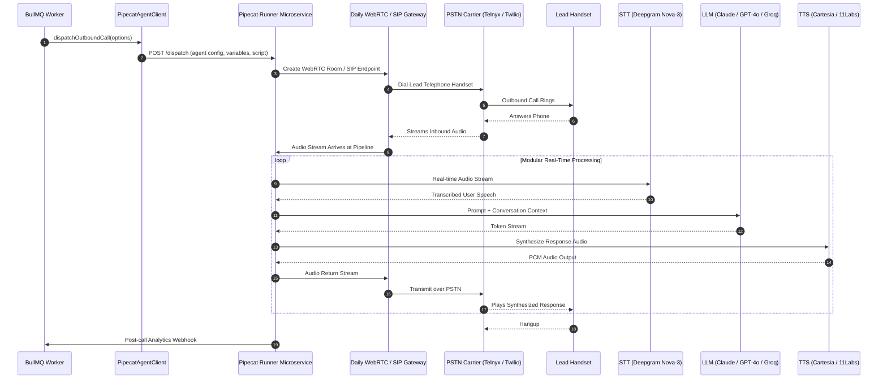

## Overview

Pipecat is an open-source framework created by Daily for building real-time voice, multimodal, and conversational AI agents. In BrokerOS, the Pipecat integration is implemented in [`integrations/voice/agents/pipecat/src/index.ts`](file:///c:/Users/Sumama/Desktop/enterprise-crm-realtors/integrations/voice/agents/pipecat/src/index.ts) under the Turborepo workspace package `@brokeros/int-agent-pipecat`.

BrokerOS administrators configure the Pipecat runner connection directly within the Web UI at **Dashboard -> Marketing -> Voice -> Settings**. All credentials and endpoint URLs are encrypted using AES-256-GCM and stored in PostgreSQL (`VoiceAgentIntegration`).

---

## Architecture and Dispatch Sequence

The Pipecat integration implements the `IVoiceAgentProvider` contract from [`@brokeros/types`](file:///c:/Users/Sumama/Desktop/enterprise-crm-realtors/packages/types). Outbound sessions initialize on a Pipecat runner microservice and connect to the lead via PSTN SIP trunks.



---

## Step 1: Deploy Pipecat Runner & Obtain Credentials

1. Deploy your Pipecat real estate agent container on your cloud infrastructure (AWS ECS, Fly.io, or GCP Cloud Run).
2. Note your runner service endpoint URL (e.g. `https://pipecat.internal.yourfirm.com`).
3. Log into [dashboard.daily.co](https://dashboard.daily.co) to retrieve your Daily.co API key for WebRTC and SIP routing.

---

## Step 2: Connect in the BrokerOS Web Dashboard

In your BrokerOS dashboard:

1. Navigate to **Dashboard -> Marketing -> Voice -> Settings**.
2. Select the **Gateways & Voice Platforms** tab (`/dashboard/marketing/voice/settings?tab=providers`).
3. Click the **AI Voice Platforms** sub-tab.
4. Click **Add Platform** and select **Pipecat AI**.
5. Fill in the modal connection fields:

| UI Modal Field | Required | Description & Example |
| :--- | :--- | :--- |
| **Engine Label / Name** | Yes | Friendly label in CRM (e.g. `Pipecat Modular Pipeline Engine`). |
| **Pipecat API Key** | Yes | Daily.co or runner authentication token. |
| **Server URL** | Yes | Deployed runner endpoint (`https://pipecat.internal.yourfirm.com`). |

6. Click **Save & Verify Engine**. BrokerOS verifies connectivity to the runner, encrypts credentials via AES-256-GCM, and saves them in `VoiceAgentIntegration`.

---

## Integration Implementation Details

The Pipecat client is defined in [`integrations/voice/agents/pipecat/src/index.ts`](file:///c:/Users/Sumama/Desktop/enterprise-crm-realtors/integrations/voice/agents/pipecat/src/index.ts).

### Live Verification Engine

Validation checks the runner configuration and credentials:

```typescript
export class PipecatAgentClient implements IVoiceAgentProvider {
  readonly platformType: VoiceAgentPlatform = 'PIPECAT';
  private apiKey: string;
  private serverUrl: string;

  constructor(credentials?: VoiceAgentCredentials) {
    this.apiKey = credentials?.apiKey || process.env.PIPECAT_API_KEY || '';
    this.serverUrl = credentials?.serverUrl || process.env.PIPECAT_RUNNER_URL || '';
  }

  async validateCredentials(credentials?: VoiceAgentCredentials): Promise<boolean> {
    const key = credentials?.apiKey || this.apiKey;
    return !!key && key.length >= 8;
  }
}
```

### Modular Pipeline Dispatch

The dispatcher posts the outbound call configuration to your Pipecat runner service:

```typescript
export async function dispatchPipecatCall(
  apiKey: string,
  serverUrl: string,
  options: SendVoiceOptions,
  credentials?: VoiceAgentCredentials,
): Promise<SendVoiceResult> {
  // Posts to Pipecat Runner /dispatch
  // Attaches project variables, prompt instructions, and Daily SIP transport parameters
}
```
