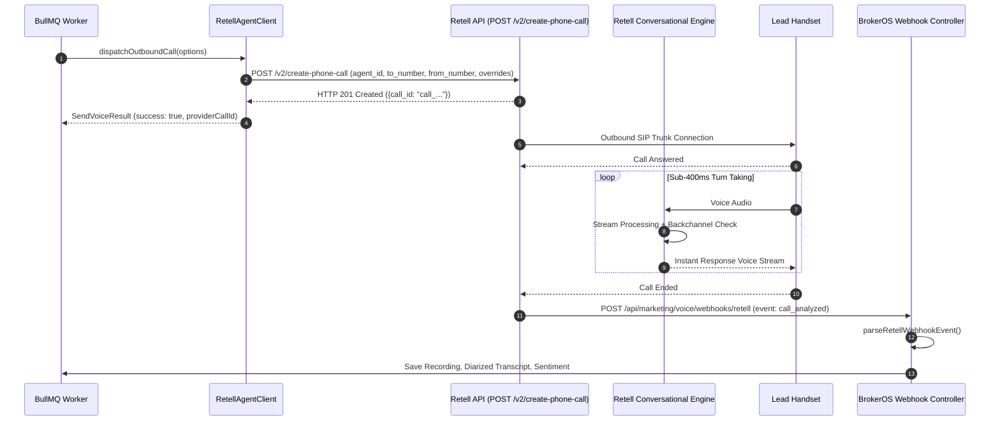

## Overview

Retell AI is a specialized conversational voice engine designed for sub-second conversational latency (~350 ms) and human-like turn-taking. In BrokerOS, the Retell integration is implemented in [`integrations/voice/agents/retell/src/index.ts`](file:///c:/Users/Sumama/Desktop/enterprise-crm-realtors/integrations/voice/agents/retell/src/index.ts) under the Turborepo workspace package `@brokeros/int-agent-retell`.

BrokerOS administrators configure and manage Retell AI directly through the Web UI at **Dashboard -> Marketing -> Voice -> Settings**. All API credentials are encrypted using AES-256-GCM and stored in PostgreSQL (`VoiceAgentIntegration`).

---

## Architecture and Dispatch Sequence

The Retell integration implements the `IVoiceAgentProvider` contract from [`@brokeros/types`](file:///c:/Users/Sumama/Desktop/enterprise-crm-realtors/packages/types).



---

## Step 1: Obtain Credentials from Retell AI

1. Log into your account at [beta.retellai.com](https://beta.retellai.com).
2. Navigate to **API Keys** in the left sidebar menu.
3. Click **Create API Key** and copy your secret key (starting with `key_`).
4. In the **Phone Numbers** tab, purchase or link an outbound phone number for Caller ID display.
5. In the **Agents** tab, create or inspect your target agent persona.

---

## Step 2: Connect in the BrokerOS Web Dashboard

In your BrokerOS dashboard:

1. Navigate to **Dashboard -> Marketing -> Voice -> Settings**.
2. Select the **Gateways & Voice Platforms** tab (`/dashboard/marketing/voice/settings?tab=providers`).
3. Click the **AI Voice Platforms** sub-tab.
4. Click **Add Platform** and select **Retell AI**.
5. Fill in the modal connection fields:

| UI Modal Field | Required | Description & Example |
| :--- | :--- | :--- |
| **Engine Label / Name** | Yes | Friendly label in CRM (e.g. `Retell Cold Calling Engine`). |
| **Retell API Key** | Yes | Secret API Key starting with `key_...`. |
| **Org ID** | Optional | Retell Organization ID if using team workspaces. |
| **Server URL** | Optional | Custom proxy URL (leave blank for standard Retell cloud). |

6. Click **Save & Verify Engine**. BrokerOS sends a live verification request to `GET https://api.retellai.com/list-agents`. Once confirmed, the key is encrypted via AES-256-GCM and stored in `VoiceAgentIntegration`.

---

## Step 3: Webhook Telemetry Handling

When a call concludes, Retell automatically posts post-call analytics and diarized transcripts to the BrokerOS webhook route:

```
https://api.yourfirm.com/api/marketing/voice/webhooks/retell
```

The BrokerOS `parseRetellWebhookEvent` parser automatically captures:
- Audio recording URL
- Speaker diarized transcript (Agent vs Lead)
- Sentiment classification (Positive, Neutral, Negative)
- Extracted client budget and location objections

---

## Integration Implementation Details

The Retell client and call dispatcher are located in [`integrations/voice/agents/retell/src/index.ts`](file:///c:/Users/Sumama/Desktop/enterprise-crm-realtors/integrations/voice/agents/retell/src/index.ts) and [`integrations/voice/agents/retell/src/retell-dispatcher.ts`](file:///c:/Users/Sumama/Desktop/enterprise-crm-realtors/integrations/voice/agents/retell/src/retell-dispatcher.ts).

### Live Verification Engine

When tested in the UI, `RetellAgentClient.validateCredentials()` executes an authenticated health check:

```typescript
export class RetellAgentClient implements IVoiceAgentProvider {
  readonly platformType: VoiceAgentPlatform = 'RETELL';
  private apiKey: string;

  constructor(credentials?: VoiceAgentCredentials) {
    this.apiKey = credentials?.apiKey || process.env.RETELL_API_KEY || '';
  }

  async validateCredentials(credentials?: VoiceAgentCredentials): Promise<boolean> {
    const key = credentials?.apiKey || this.apiKey;
    if (!key) return false;
    try {
      const res = await fetch('https://api.retellai.com/list-agents', {
        headers: { Authorization: `Bearer ${key}` },
      });
      return res.status === 200;
    } catch {
      return key.startsWith('key_') || key.length >= 20;
    }
  }
}
```

### Outbound Call Dispatch and Overrides

The dispatcher resolves outbound phone numbers, matches agents, and builds runtime configuration overrides:

```typescript
const agentOverrideProps: Record<string, any> = {};

if (voiceModel) agentOverrideProps.voice_model = voiceModel;
if (options.voiceSpeed !== undefined && options.voiceSpeed !== 1.0) {
  agentOverrideProps.voice_speed = options.voiceSpeed;
}

const emotion = options.retellEmotion || options.voiceEmotion;
if (emotion && emotion !== 'normal' && emotion !== 'none') {
  agentOverrideProps.voice_emotion = emotion;
}

const ambSound = options.retellAmbientSound || options.ambientSound;
if (ambSound && ambSound !== 'none' && ambSound !== 'off') {
  agentOverrideProps.ambient_sound = ambSound;
  agentOverrideProps.ambient_sound_volume = options.ambientSoundVolume ?? 0.8;
}

const backchannel = options.retellBackchannel ?? options.enableBackchannel;
if (backchannel !== undefined) {
  agentOverrideProps.enable_backchannel = backchannel;
}

const payload: any = {
  agent_id: targetAgentId,
  override_agent_id: targetAgentId,
  to_number: options.toPhone,
  from_number: fromNumber,
  retell_llm_dynamic_variables: {
    ...options.variables,
    system_prompt: options.scriptPrompt,
  },
};

if (Object.keys(agentOverrideProps).length > 0) {
  payload.agent_override = { agent: agentOverrideProps };
}
```
