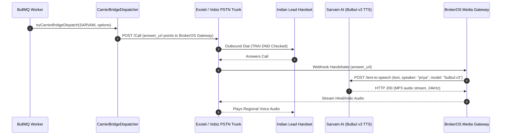

## Overview

In the Indian real estate market, connecting with prospective buyers in their native regional language significantly increases engagement, trust, and site visit conversion. Sarvam AI specializes in language models and neural speech synthesis trained specifically on Indic languages and accents.

In BrokerOS, the Sarvam integration lives in [`integrations/voice/agents/sarvam/src/index.ts`](file:///c:/Users/Sumama/Desktop/enterprise-crm-realtors/integrations/voice/agents/sarvam/src/index.ts) under the Turborepo workspace package `@brokeros/int-agent-sarvam`. BrokerOS administrators configure Sarvam directly through the Web UI at **Dashboard -> Marketing -> Voice -> Settings**. Because Sarvam is a streaming voice synthesis and transcription engine without a standalone PSTN trunk, BrokerOS couples Sarvam with local carrier bridges (Exotel or Vobiz) to execute telecalling campaigns compliant with TRAI regulations.

---

## Architecture and Dispatch Sequence

The Sarvam integration implements the `IVoiceAgentProvider` contract from [`@brokeros/types`](file:///c:/Users/Sumama/Desktop/enterprise-crm-realtors/packages/types). Outbound calls route through a PSTN Carrier Bridge while speech synthesis streams from Sarvam's Bulbul v3 engine.



---

## Step 1: Obtain Credentials from Sarvam AI

1. Log into your account at [dashboard.sarvam.ai](https://dashboard.sarvam.ai).
2. Navigate to **API Keys** in your user dashboard.
3. Generate and copy your subscription key.

---

## Step 2: Connect in the BrokerOS Web Dashboard

In your BrokerOS dashboard:

1. Navigate to **Dashboard -> Marketing -> Voice -> Settings**.
2. Select the **Gateways & Voice Platforms** tab (`/dashboard/marketing/voice/settings?tab=providers`).
3. Under the **AI Voice Platforms** sub-tab, click **Add Platform** and select **Sarvam AI (India)**.
4. Fill in the modal connection fields:

| UI Modal Field | Required | Description & Example |
| :--- | :--- | :--- |
| **Engine Label / Name** | Yes | Friendly label in CRM (e.g. `Sarvam Indic Regional Engine`). |
| **Sarvam API Key** | Yes | API Subscription Key from Sarvam dashboard. |

5. Click **Save & Verify Engine**. BrokerOS verifies the key, encrypts it via AES-256-GCM, and saves it in `VoiceAgentIntegration`.
6. Navigate to the **Telephony Gateways** sub-tab and ensure you have an active Exotel or Vobiz carrier line connected to handle the physical outbound PSTN dialing.

---

## Supported Indic Languages & Accents

| Language | Code | Common Persona | Real Estate Regional Focus |
| :--- | :--- | :--- | :--- |
| **Hindi** | `hi-IN` | `priya`, `rahul` | Delhi-NCR, Mumbai, UP, Rajasthan, MP |
| **Tamil** | `ta-IN` | `kavitha`, `vijay` | Chennai, Coimbatore, Madurai |
| **Telugu** | `te-IN` | `mani`, `suhani` | Hyderabad, Visakhapatnam, Vijayawada |
| **Marathi** | `mr-IN` | `rupali`, `soham` | Mumbai, Pune, Nagpur, Nashik |
| **Kannada** | `kn-IN` | `gokul`, `roopa` | Bangalore, Mysore, Hubli-Dharwad |
| **Bengali** | `bn-IN` | `ishita`, `dev` | Kolkata, Siliguri, Durgapur |
| **Gujarati** | `gu-IN` | `amit`, `tanya` | Ahmedabad, Surat, Vadodara |
| **Malayalam** | `ml-IN` | `sunny`, `shruti` | Kochi, Thiruvananthapuram, Kozhikode |

---

## Writing Bilingual & Hinglish Real Estate Scripts

Indian property buyers frequently code-switch between Hindi and English during sales calls. Sarvam's Bulbul v3 handles natural colloquial phrases seamlessly:

```text
Opening Statement:
"Namaste Rohit ji, main Priya bol rahi hoon Godrej Woods Noida se. 
Aapne hamare new launch sector-43 ke 3BHK luxury apartments ke liye enquire kiya tha. 
Kya yeh right time hai aapse 2 minute baat karne ke liye?"

Objection Handling (Budget):
"Bilkul sir, hamare paas flexible subvention plans aur 10:90 payment options bhi available hain. 
Starting price 1.85 Cr se hai with private golf view balconies. 
Kya aap iss Sunday site visit schedule karna chahenge?"
```

---

## Integration Implementation Details

The Sarvam integration source code is located in [`integrations/voice/agents/sarvam/src/index.ts`](file:///c:/Users/Sumama/Desktop/enterprise-crm-realtors/integrations/voice/agents/sarvam/src/index.ts) and [`integrations/voice/agents/sarvam/src/sarvam-tts.ts`](file:///c:/Users/Sumama/Desktop/enterprise-crm-realtors/integrations/voice/agents/sarvam/src/sarvam-tts.ts).

### Bulbul v3 Neural Voice Synthesis

The synthesizer calls Sarvam's `/text-to-speech` endpoint with 24kHz sampling and selected voice personas:

```typescript
export async function synthesizeSarvamAudio(
  apiKey: string,
  text: string,
  voiceId: string,
): Promise<{ audioBuffer: Buffer; contentType: string }> {
  const validSpeakers = [
    'shubh', 'aditya', 'ritu', 'priya', 'neha', 'rahul', 'pooja', 'rohan',
    'simran', 'kavya', 'amit', 'dev', 'ishita', 'shreya', 'ratan', 'varun',
    'manan', 'sumit', 'roopa', 'kabir', 'aayan', 'ashutosh', 'advait',
    'anand', 'tanya', 'tarun', 'sunny', 'mani', 'gokul', 'vijay',
    'shruti', 'suhani', 'mohit', 'kavitha', 'rehan', 'soham', 'rupali',
  ];

  const cleanedId = (voiceId || '').toLowerCase().trim();
  const speaker = validSpeakers.includes(cleanedId) 
    ? cleanedId 
    : (cleanedId.includes('rahul') ? 'rahul' : 'priya');

  const res = await fetch('https://api.sarvam.ai/text-to-speech', {
    method: 'POST',
    headers: {
      'api-subscription-key': apiKey,
      'Content-Type': 'application/json',
    },
    body: JSON.stringify({
      text,
      language_code: 'hi-IN',
      speaker,
      model: 'bulbul:v3',
      pace: 1.0,
      temperature: 0.6,
      speech_sample_rate: 24000,
      output_audio_codec: 'mp3',
    }),
  });

  if (res.status === 200) {
    const data = (await res.json()) as any;
    const base64Audio = data.audios?.[0];
    if (base64Audio) {
      return {
        audioBuffer: Buffer.from(base64Audio, 'base64'),
        contentType: 'audio/mpeg',
      };
    }
  }
}
```
