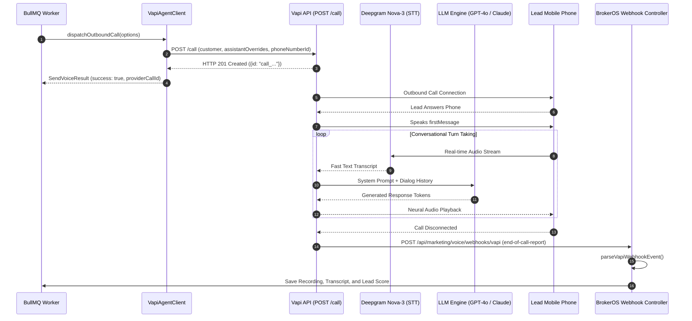

## Overview

Vapi is an AI voice platform that orchestrates real-time speech recognition, LLM reasoning, and neural text-to-speech synthesis into conversational voice agents. In BrokerOS, the Vapi integration is implemented in [`integrations/voice/agents/vapi/src/index.ts`](file:///c:/Users/Sumama/Desktop/enterprise-crm-realtors/integrations/voice/agents/vapi/src/index.ts) under the Turborepo workspace package `@brokeros/int-agent-vapi`.

BrokerOS administrators configure and manage Vapi directly inside the Web UI at **Dashboard -> Marketing -> Voice -> Settings**. All API credentials are encrypted with AES-256-GCM and stored in PostgreSQL (`VoiceAgentIntegration`), requiring zero server restarts or `.env` modifications.

---

## Architecture and Dispatch Sequence

The Vapi integration implements the `IVoiceAgentProvider` contract from [`@brokeros/types`](file:///c:/Users/Sumama/Desktop/enterprise-crm-realtors/packages/types). Outbound calls can be dispatched either directly via Vapi's telephone infrastructure or coupled with custom Twilio SIP credentials.



---

## Step 1: Obtain Credentials from Vapi

1. Log into your account at [dashboard.vapi.ai](https://dashboard.vapi.ai).
2. Navigate to **API Keys** in the left sidebar menu.
3. Click **Create API Key** and copy your private key.
4. (Optional) Under **Phone Numbers**, purchase a number or import your Twilio SIP credentials to dial using your firm's caller ID.

---

## Step 2: Connect in the BrokerOS Web Dashboard

In your BrokerOS dashboard:

1. Navigate to **Dashboard -> Marketing -> Voice -> Settings**.
2. Select the **Gateways & Voice Platforms** tab (`/dashboard/marketing/voice/settings?tab=providers`).
3. Click the **AI Voice Platforms** sub-tab.
4. Click **Add Platform** and choose **Vapi AI**.
5. Fill in the connection modal fields:

| UI Modal Field | Required | Description & Example |
| :--- | :--- | :--- |
| **Engine Label / Name** | Yes | Friendly label in CRM (e.g. `Vapi Production Engine`). |
| **Vapi API Key** | Yes | Secret API Key from Vapi dashboard. |
| **Org ID** | Optional | Vapi Organization UUID if utilizing multi-workspace tenancy. |
| **Server URL** | Optional | Custom proxy URL (leave blank for default `api.vapi.ai`). |

6. Click **Save & Verify Engine**. BrokerOS immediately tests authentication via `GET https://api.vapi.ai/assistant`, discovers configured assistants, encrypts the key with AES-256-GCM, and saves it in `VoiceAgentIntegration`.

---

## Step 3: Webhook Telemetry Handling

BrokerOS automatically configures the webhook destination URL during outbound dispatch calls. When a call completes, Vapi posts an `end-of-call-report` event to:

```
https://api.yourfirm.com/api/marketing/voice/webhooks/vapi
```

The BrokerOS `parseVapiWebhookEvent` parser automatically extracts:
- Audio recording URL (streamed to CRM timeline)
- Complete turn-by-turn speech transcript
- Customer sentiment analysis (Positive, Neutral, Negative)
- Qualification parameters (Budget, Timeline, Bedroom preferences)
- Disposition status (`COMPLETED`, `NO_ANSWER`, `BUSY`, `VOICEMAIL`, `FAILED`)

---

## Integration Implementation Details

The Vapi integration logic is maintained in [`integrations/voice/agents/vapi/src/index.ts`](file:///c:/Users/Sumama/Desktop/enterprise-crm-realtors/integrations/voice/agents/vapi/src/index.ts) and [`integrations/voice/agents/vapi/src/vapi-dispatcher.ts`](file:///c:/Users/Sumama/Desktop/enterprise-crm-realtors/integrations/voice/agents/vapi/src/vapi-dispatcher.ts).

### Live Verification Engine

When saved in the UI, `VapiAgentClient.validateCredentials()` executes an authenticated health check:

```typescript
export class VapiAgentClient implements IVoiceAgentProvider {
  readonly platformType: VoiceAgentPlatform = 'VAPI';
  private apiKey: string;

  constructor(credentials?: VoiceAgentCredentials) {
    this.apiKey = credentials?.apiKey || process.env.VAPI_API_KEY || '';
  }

  async validateCredentials(credentials?: VoiceAgentCredentials): Promise<boolean> {
    const key = credentials?.apiKey || this.apiKey;
    if (!key) return false;
    try {
      const res = await fetch('https://api.vapi.ai/assistant', {
        headers: { Authorization: `Bearer ${key}` },
      });
      return res.status === 200;
    } catch {
      return key.length >= 20;
    }
  }
}
```

### Outbound Call Dispatch Payload

BrokerOS supports both pre-existing assistant IDs and transient inline assistants. The dispatcher maps the requested model to Vapi's provider hierarchy:

```typescript
// Map Model Provider
let vapiModelProvider = 'openai';
let cleanModel = (options.llmModel || '').toLowerCase();
let vapiModel = 'gpt-4o-mini';

if (cleanModel.includes('gpt-4o-mini')) {
  vapiModelProvider = 'openai';
  vapiModel = 'gpt-4o-mini';
} else if (cleanModel.includes('gpt-4o')) {
  vapiModelProvider = 'openai';
  vapiModel = 'gpt-4o';
} else if (cleanModel.includes('claude-3-5-sonnet')) {
  vapiModelProvider = 'anthropic';
  vapiModel = 'claude-3-5-sonnet-20241022';
} else if (cleanModel.includes('llama') || cleanModel.includes('groq')) {
  vapiModelProvider = 'groq';
  vapiModel = 'llama-3.3-70b-versatile';
} else if (cleanModel.includes('gemini')) {
  vapiModelProvider = 'google';
  vapiModel = 'gemini-1.5-flash';
}
```
