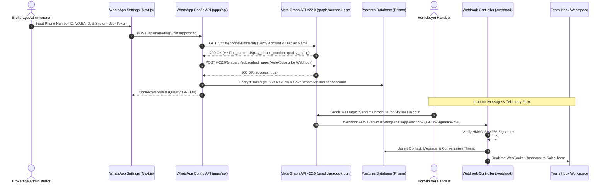

## Official WhatsApp Business Messaging

BrokerOS connects directly to **Meta WhatsApp Cloud API v22.0**, bypassing unverified third-party scrapers or brittle QR-code gateways. Official Cloud API integration guarantees enterprise reliability, verified badge support, 24-hour service conversation windows, pre-approved marketing templates, and cryptographic delivery tracking.

All WhatsApp communication logic is decoupled into the [`@brokeros/int-whatsapp`](file:///c:/Users/Sumama/Desktop/enterprise-crm-realtors/integrations/whatsapp/) integration adapter, while the NestJS backend ([`apps/api/src/marketing/whatsapp/`](file:///c:/Users/Sumama/Desktop/enterprise-crm-realtors/apps/api/src/marketing/whatsapp/)) orchestrates team inbox threads, AI reply synthesis, broadcast queues, and inbound webhook processing.

---

## Architecture & Integration Pipeline



---

## Required Credentials & Parameters

To link your WhatsApp Business Account (WABA) with BrokerOS, retrieve the following values from your Meta Business Manager and Meta Developer accounts:

| Parameter Field | Location in BrokerOS Settings | Format & Description |
| :--- | :--- | :--- |
| **Phone Number ID** | `Phone Number ID` | Numeric ID for the verified WhatsApp phone number (e.g., `109283746501928`). |
| **WABA ID** | `WhatsApp Business Account ID (WABA)` | Numeric ID of the parent WhatsApp Business Account (e.g., `293847561029384`). |
| **System User Access Token** | `System User Access Token` | Permanent access token starting with `EAAB...` generated under Meta Business Settings. |
| **Webhook Callback URL** | In Meta Developer Portal | Endpoint: `https://api.yourdomain.com/api/marketing/whatsapp/webhook`. |
| **Verification Token** | In Meta Developer Portal | Verification secret string (default: `brokeros-verify-token-secret`). |

---

## Step-by-Step Configuration Guide

<Steps>
  <Step title="Create a Meta Business App">
    1. Log in to the [Meta for Developers Portal](https://developers.facebook.com).
    2. Click **My Apps** and then **Create App**.
    3. Choose **Other** as the use case, click **Next**, and select **Business** as the app type.
    4. Provide an app display name (e.g., *Skyline Realty CRM*) and link it to your primary Meta Business Portfolio.
    5. On the App Dashboard, scroll down to **Add products to your app** and click **Set up** on the **WhatsApp** tile.
  </Step>

  <Step title="Locate Phone Number ID and WABA ID">
    1. In the left-hand navigation of your Meta App, expand **WhatsApp** and click **API Setup**.
    2. Under **Step 1: Select phone numbers**, locate your live WhatsApp phone number.
    3. Copy the **Phone number ID** displayed directly below the phone number dropdown.
    4. Copy the **WhatsApp Business Account ID** displayed below the Phone number ID.
  </Step>

  <Step title="Generate a Permanent System User Token">
    Temporary access tokens from the API Setup screen expire within 24 hours. To generate a permanent production token:

    1. Open [Meta Business Settings](https://business.facebook.com/settings).
    2. In the left sidebar, navigate to **Users -> System Users**.
    3. Click **Add**, name the system user (e.g., `BrokerOS System User`), and assign the **Admin** role.
    4. Click **Assign Assets**, select **WhatsApp Accounts**, select your WABA, and toggle on **Full control (Manage WhatsApp Business Account)**. Save changes.
    5. Click **Generate New Token**, choose your Meta Business App from the dropdown, and set token expiration to **Never**.
    6. In the permissions list, check the following required scopes:
       - `whatsapp_business_messaging` (send and receive messages)
       - `whatsapp_business_management` (read templates and phone number status)
    7. Click **Generate Token** and immediately copy the token string (`EAAB...`).
  </Step>

  <Step title="Connect Account in BrokerOS Settings">
    In the BrokerOS web application:

    1. Navigate to **Dashboard -> Marketing -> WhatsApp -> Settings** (`/dashboard/marketing/whatsapp/settings`).
    2. Ensure the **Meta WABA Account** tab is selected.
    3. Enter your **Phone Number ID**, **WhatsApp Business Account ID (WABA)**, and the **System User Access Token**.
    4. Click **Connect Account** (or **Update Credentials**):
       - BrokerOS executes a pre-flight request to `GET https://graph.facebook.com/v22.0/{phoneNumberId}` to verify credential validity.
       - The system automatically triggers `POST https://graph.facebook.com/v22.0/{wabaId}/subscribed_apps` to subscribe your WABA to app webhooks.
       - Credentials are encrypted using **AES-256-GCM** and saved in PostgreSQL (`WhatsAppBusinessAccount`).
       - Upon success, the card displays your verified business name, phone number, and quality rating (e.g., `GREEN`).
  </Step>

  <Step title="Configure Meta Webhook and Subscriptions">
    To receive customer messages, button clicks, and delivery receipts in real time:

    1. In BrokerOS, switch to the **Webhook & Diagnostics** tab (`/dashboard/marketing/whatsapp/settings?tab=webhook`).
    2. Copy the **Meta Webhook Callback URL**:
       ```
       https://api.yourdomain.com/api/marketing/whatsapp/webhook
       ```
    3. Copy the displayed **Verification Token** (or configure your own custom token).
    4. In the Meta Developer Portal, navigate to **WhatsApp -> Configuration -> Webhook** and click **Edit**.
    5. Paste the Callback URL and Verify Token, then click **Verify and Save**. BrokerOS verifies the `hub.challenge` handshake instantly.
    6. Under **Webhook fields**, click **Manage** and subscribe to:
       - `messages` (inbound customer text, button responses, and attachments)
       - `message_template_status_update` (template approvals and rejections)
  </Step>
</Steps>

---

## Meta Graph API v22.0 Integration Contract

The `@brokeros/int-whatsapp` package encapsulates all direct communication with Meta Graph API endpoints:

| Endpoint & HTTP Method | Target Resource | Description & Usage |
| :--- | :--- | :--- |
| `GET /v22.0/{phoneNumberId}` | Phone Number Metadata | Verifies credentials, fetches verified business name, display number, and quality score. |
| `POST /v22.0/{wabaId}/subscribed_apps` | WABA Subscribed Apps | Links your Meta App to the WhatsApp account for automated event delivery. |
| `POST /v22.0/{phoneNumberId}/messages` | Outbound Dispatch | Transmits text messages, interactive quick-reply buttons, list sections, and templates. |
| `GET /v22.0/{wabaId}/message_templates` | Template Catalog | Synchronizes approved marketing, utility, and authentication templates into the CRM. |
| `POST /v22.0/{phoneNumberId}/media` | Media Upload | Uploads property brochures, floor plans, and site photos for media message delivery. |
| `POST /v22.0/{phoneNumberId}/register` | Registration PIN | Registers telephone numbers configured with two-step verification PINs. |

---

## Security Model: Encryption & Webhook Verification

BrokerOS protects WhatsApp communications and credentials using multi-layered enterprise safeguards:

1. **At-Rest AES-256-GCM Encryption**: System User Access Tokens are encrypted with an initialization vector (IV) and authentication tag prior to database storage in [`packages/prisma/schema.prisma`](file:///c:/Users/Sumama/Desktop/enterprise-crm-realtors/packages/prisma/schema.prisma#L3092). Plaintext access tokens are never written to disk or logs.
2. **In-Transit Webhook Integrity**: Inbound webhooks from Meta are validated against the `x-hub-signature-256` header. The server computes an HMAC-SHA256 signature using your Meta App Secret to ensure payloads originate exclusively from Meta servers.
3. **SSRF Guard**: Media URLs and dynamic asset links undergo strict Server-Side Request Forgery validation (`ssrf-guard.ts`) to prevent internal network probing.
4. **Zero Downtime Updates**: Modifying access tokens or phone number mappings through the settings interface takes effect immediately across all workers without requiring server restarts.

---